# Enterprise Knowledge Agent

Enterprise Knowledge Agent is a locally runnable, containerized
retrieval-augmented generation (RAG) platform. You create isolated
"applications", upload `.txt`/`.md` documents, have them chunked and embedded into
a vector store, configure prompt-driven "agents", and then run those agents — or
chat — against the knowledge to produce source-grounded Markdown answers with
citations. This README takes you from a fresh clone to a running stack, explains
how the system is built, and shows how to operate, test, and troubleshoot it.

**Status:** Working local development build. The end-to-end RAG path (ingest →
retrieve → generate → cite) is implemented and runnable via Docker Compose.
There is currently **no end-user authentication** — see
[Security](#security). Requirements/architecture documents describe some features
(e.g. Keycloak auth, additional file types) that are **not** in the current build;
those are labeled **Planned** below.

> This repository is a proof-of-concept / internal platform. It is intended for
> local development and evaluation, not production deployment.

---

## Table of contents

- [Overview](#overview)
- [Key features](#key-features)
- [Screenshots](#screenshots)
- [Architecture](#architecture)
- [Technology stack](#technology-stack)
- [Repository structure](#repository-structure)
- [Prerequisites](#prerequisites)
- [Quick start](#quick-start)
- [Detailed setup](#detailed-setup)
- [Configuration](#configuration)
- [Running the project](#running-the-project)
- [Usage guide](#usage-guide)
- [API documentation](#api-documentation)
- [Events and real-time communication](#events-and-real-time-communication)
- [Data model](#data-model)
- [Background processing](#background-processing)
- [Security](#security)
- [Health and operations](#health-and-operations)
- [Testing](#testing)
- [Troubleshooting](#troubleshooting)
- [Development workflow](#development-workflow)
- [Deployment](#deployment)
- [Backup and restore](#backup-and-restore)
- [Accessibility](#accessibility)
- [Known limitations](#known-limitations)
- [Contributing](#contributing)
- [License](#license)
- [Support](#support)
- [Documentation index](#documentation-index)

---

## Overview

The platform delivers a complete, working RAG path with a deliberately narrow
scope: get one knowledge-to-answer flow solid before adding breadth.

**What it does**

1. Create an application (an isolation boundary for knowledge, agents, and outputs).
2. Upload `.txt` / `.md` files as knowledge.
3. Process them in the background: parse → chunk → embed → index into `pgvector`.
4. Author a prompt-driven agent with generation and retrieval parameters.
5. Run the agent asynchronously, or chat against the knowledge with token streaming.
6. Review grounded Markdown output plus the evidence and citations behind it.

**Who it is for**

- Evaluators who want to see a working enterprise-style RAG flow locally.
- Developers extending the ingestion/retrieval/generation pipeline.
- Operators exercising the containerized stack, queues, and workers.

**Primary workflow**

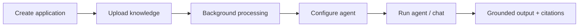

---

## Key features

Status legend: **Implemented** = present and runnable in this build;
**Partial** = present but limited; **Planned** = described in the design docs but
not in this build.

| Area | Capability | Status |
| --- | --- | --- |
| Applications | Create, update, archive, restore, delete | Implemented |
| Knowledge | Upload/replace `.txt`/`.md`, list, preview, disable/enable, reprocess, delete | Implemented |
| Processing | Parse (Markdig) → token-aware chunk → Azure OpenAI embeddings → pgvector | Implemented |
| Agents | Create/edit prompt + generation/retrieval params, enable/disable | Implemented |
| Runs | Async execution with config snapshot, stages, progress, cancel, retry | Implemented |
| Retrieval | Semantic + hybrid (vector + full-text) search | Implemented |
| Outputs | List/detail, edit Markdown, regenerate, delete, citations/evidence | Implemented |
| Chat | Conversations with server-sent-events token streaming | Implemented |
| Dashboards | Platform + per-application metrics | Implemented |
| Realtime | SignalR live updates for jobs, runs, dashboards, operations | Implemented |
| Observability | Health checks, worker heartbeats, queue depths, audit trail | Implemented |
| Authorization | 13-flag capability model + app isolation and read-only guards | Partial |
| Authentication | End-user login / identity | Planned |
| Ingestion | PDF / DOCX / image / audio / video | Planned |
| Export | DOCX / PDF output, generated-exports bucket usage | Planned |
| Providers | Multiple LLM providers, model fallback, Redis cache | Planned |

---

## Screenshots

Captured from the running application (dark theme, 1440×1000). The full inventory
and capture standards are in
[docs/screenshots/README.md](docs/screenshots/README.md).

**Platform dashboard** — cross-application health and throughput.

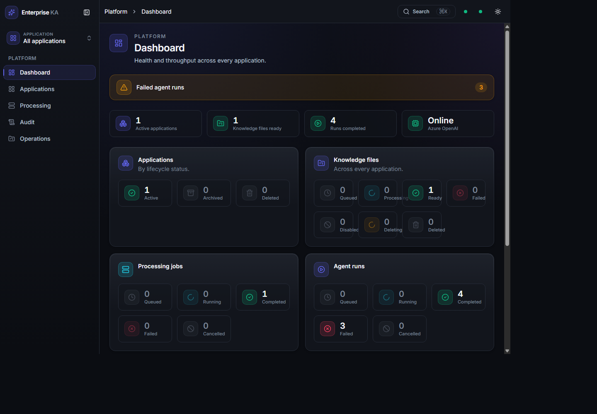

**Applications** — list, create, and manage applications.

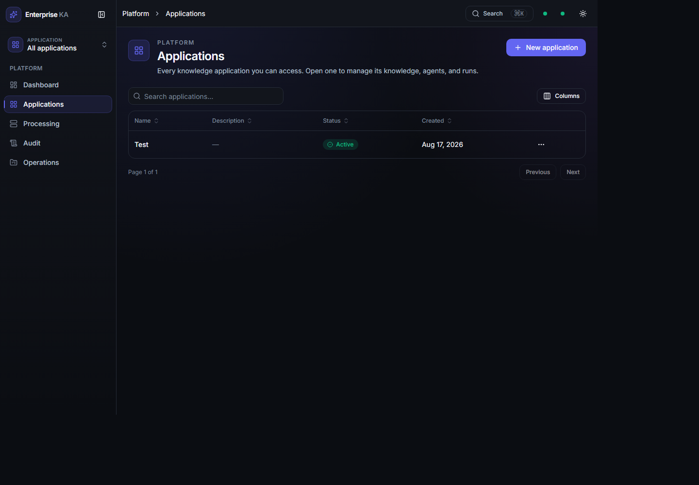

**Knowledge files** — per-application documents and their processing status.

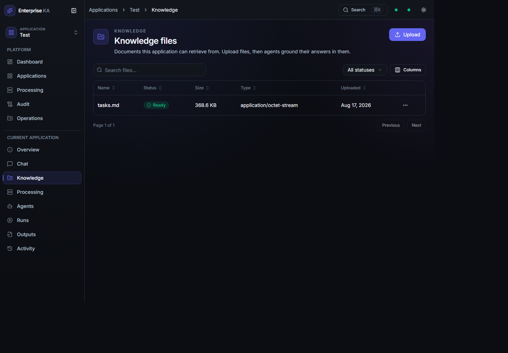

**Agent detail** — prompt (Monaco editor) plus generation and retrieval settings.

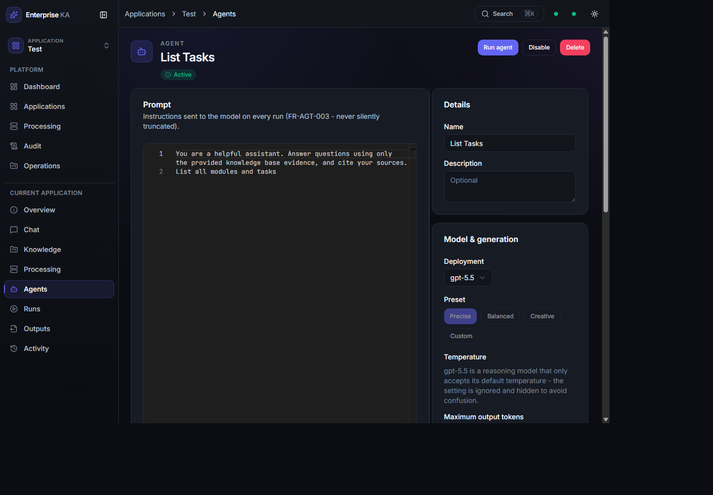

**Run detail** — stage timeline, config snapshot, and retrieved evidence.

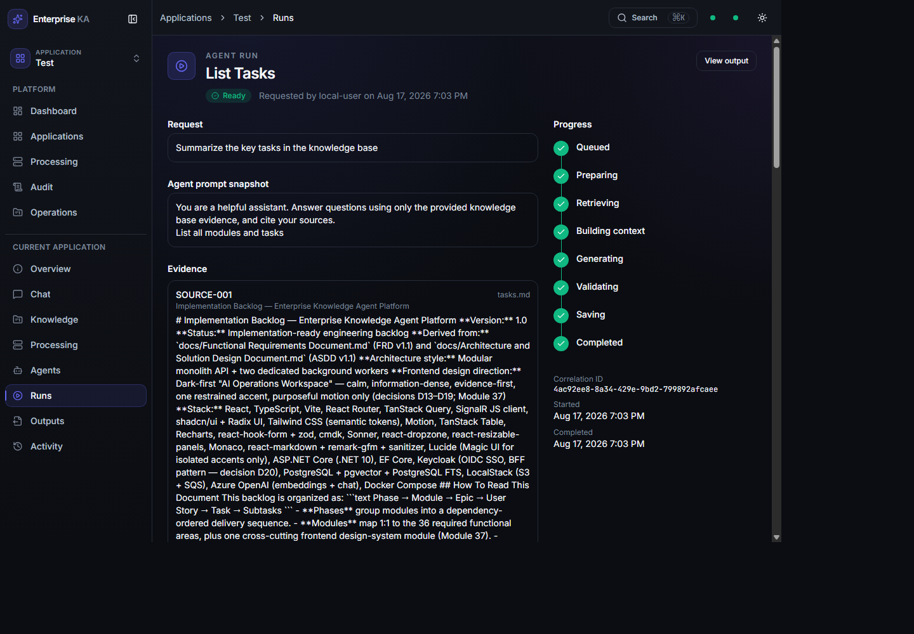

**Output detail** — grounded Markdown with citations and Preview/Source/Split views.

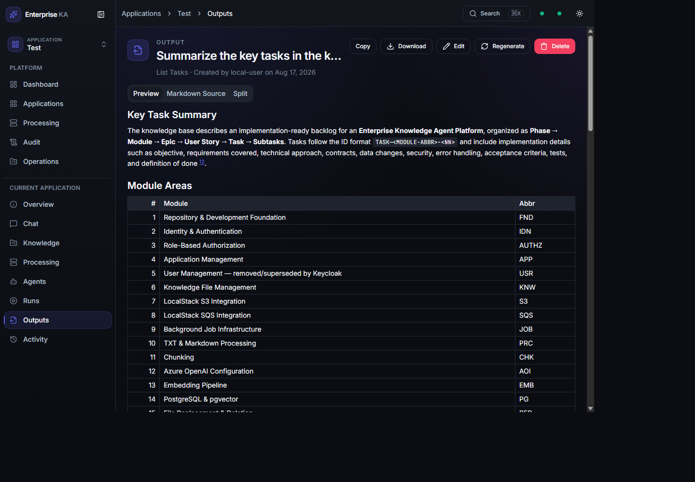

**Chat** — grounded conversation with token streaming and read-only settings.

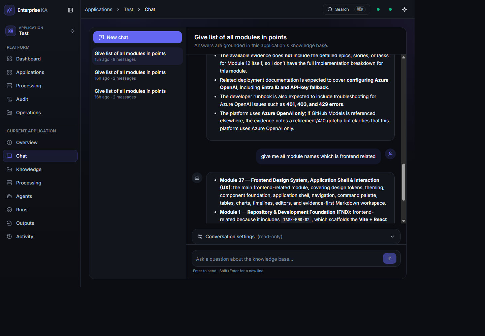

**Operations** — component health, worker heartbeats, and queue depths.

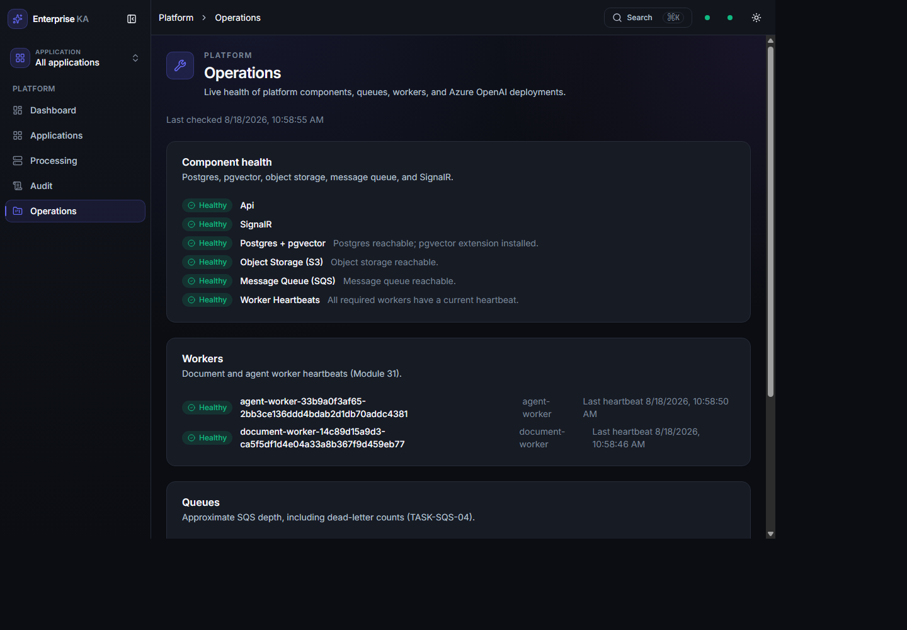

---

## Architecture

A layered .NET backend (domain ← application ← infrastructure ← api/workers) plus
an independent React SPA. PostgreSQL with `pgvector` is the system of record; S3
stores raw files; SQS carries async jobs; Azure OpenAI provides embeddings and
chat. Mutations use a transactional outbox so a domain write and its queue message
commit atomically; workers consume the messages and relay progress back to the API,
which fans out over SignalR to the SPA.

### System context

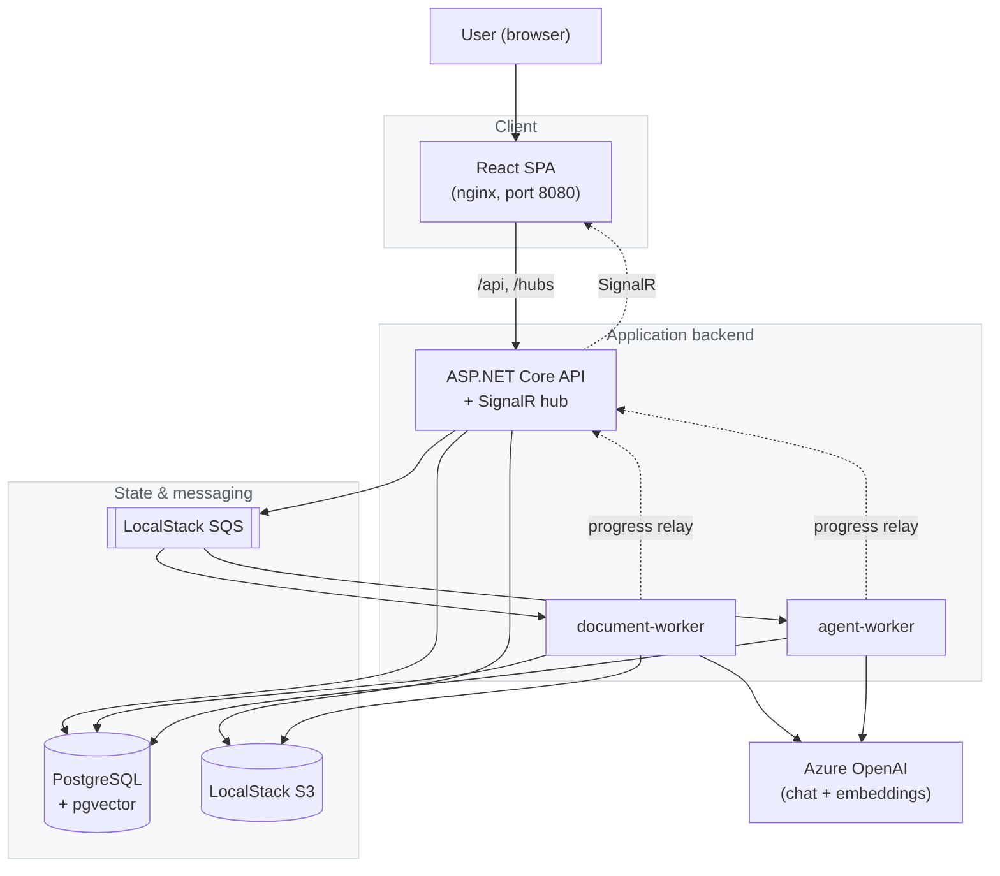

### Service topology (Docker Compose)

Only `frontend` and `api` publish host ports by default; `postgres` and
`localstack` host ports are published only under the `diagnostics` profile.

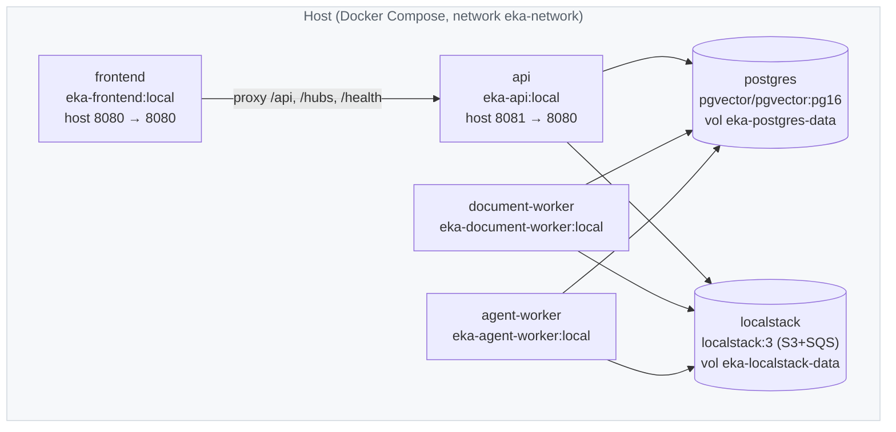

Editable diagram sources live in [docs/diagrams/](docs/diagrams/). Processing and
run flows are shown under [Background processing](#background-processing); trust
boundaries under [Security](#security).

---

## Technology stack

| Layer | Technology | Responsibility |
| --- | --- | --- |
| Frontend | React 19, Vite 8, TypeScript 6, Tailwind v4, Radix/shadcn, TanStack Query/Table, Monaco, `@microsoft/signalr` | SPA UI, live updates, editor |
| API | ASP.NET Core (.NET 10) minimal APIs | HTTP endpoints, SignalR hub, hosted services |
| Workers | .NET 10 `BackgroundService` | SQS consumers for ingestion and agent execution |
| Data | PostgreSQL 16 + pgvector, EF Core 10 + Npgsql | Relational + vector storage, migrations |
| Object store | LocalStack S3 (AWSSDK.S3) | Raw source-file storage |
| Messaging | LocalStack SQS (AWSSDK.SQS) | Async jobs and dead-letter queues |
| AI | Azure OpenAI (Azure.AI.OpenAI, Azure.Identity) | Chat completions and embeddings |
| Observability | Serilog, OpenTelemetry (console exporters) | Structured logs, metrics, traces |
| Orchestration | Docker Compose v2 | Local multi-service runtime |
| CI | GitHub Actions | Build/test/lint/format, image builds, secret scan |

---

## Repository structure

```
.
├── EnterpriseKnowledgeAgent.slnx     # .NET solution
├── docker-compose.yml                # Core stack (6 services)
├── docker-compose.override.yml       # "diagnostics" profile (host DB/LocalStack ports)
├── .env.example                      # Environment template (copy to .env)
├── src/
│   ├── api/                          # ASP.NET Core API (entry point) + SignalR hub
│   ├── application/                  # Use cases, DTOs, orchestrators
│   ├── domain/                       # Entities, value objects, enums
│   ├── infrastructure/               # EF Core DbContext + migrations, S3/SQS/AOAI clients
│   ├── shared/                       # Cross-process contracts (messages, correlation id)
│   ├── document-worker/              # Background worker: ingestion pipeline
│   ├── agent-worker/                 # Background worker: agent execution
│   └── frontend/                     # React + TypeScript + Vite SPA (nginx in prod)
├── tests/
│   ├── unit/                         # Api, Application, Architecture, Domain, Shared
│   ├── integration/                  # Infrastructure (Testcontainers Postgres)
│   ├── security/                     # (empty placeholder)
│   └── end-to-end/                   # (empty placeholder)
├── deploy/
│   ├── postgres/                     # migrate / backup / restore scripts (.ps1 + .sh)
│   ├── localstack/                   # S3 bucket + SQS queue init scripts
│   └── scripts/                      # Azure OpenAI connectivity check
└── docs/                             # Requirements, architecture, this README's assets
```

Entry points: `src/api/Program.cs`, `src/document-worker/Program.cs`,
`src/agent-worker/Program.cs`, and the SPA under `src/frontend`.

---

## Prerequisites

| Requirement | Version | Needed for |
| --- | --- | --- |
| [Docker Desktop](https://www.docker.com/products/docker-desktop/) | Compose v2 | Running the stack; integration tests (Testcontainers) |
| [.NET SDK](https://dotnet.microsoft.com/download) | 10.0.x | Building/testing the backend, EF migrations |
| [Node.js](https://nodejs.org/) + npm | 22+ | Building/testing the frontend, dev server |
| PowerShell (`pwsh`) or bash | — | `deploy/` helper scripts ship as `.ps1` and `.sh` |
| [Azure CLI](https://learn.microsoft.com/cli/azure/install-azure-cli) (`az`) | current | Optional Azure OpenAI connectivity check only |
| Azure OpenAI resource | — | Embeddings + chat (ingestion/generation fail without one) |

You can bring the whole stack up with only Docker installed. The .NET and Node
SDKs are needed for local (outside-container) development and running tests.

---

## Quick start

Shortest verified path from clone to a running app. Run from the repository root.

```powershell
# 1. Environment file (safe local defaults; add Azure OpenAI values to use AI features)
cp .env.example .env

# 2. Build and start all services
docker compose up -d --build

# 3. Wait until every service is healthy
docker compose ps

# 4. Apply database migrations (needs the diagnostics profile to reach Postgres)
docker compose --profile diagnostics up -d
./deploy/postgres/migrate.ps1        # or ./deploy/postgres/migrate.sh
```

Then open **http://localhost:8080**. There is no login. The stack starts with an
empty database — create your first application from the **Applications** page (see
[Usage guide](#usage-guide)).

- **Expected result:** `docker compose ps` shows `postgres` and `localstack` as
  `healthy` and `api` `healthy`; the SPA loads the Platform dashboard.
- **AI features (ingestion/generation)** require a real Azure OpenAI endpoint and
  deployments in `.env`; without them the UI works but processing and runs fail at
  call time. See [Configuration](#configuration) and [Troubleshooting](#troubleshooting).

---

## Detailed setup

### 1. Clone and create the environment file

```powershell
cp .env.example .env
```

`.env` is auto-loaded by Docker Compose and is git-ignored. Read the
"SECRET STRATEGY" header in [.env.example](.env.example): local-only,
low-sensitivity values (LocalStack fake credentials, the local Postgres dev
password, port overrides) belong in `.env`; a real Azure OpenAI API key belongs in
`dotnet user-secrets`, never in `.env`.

### 2. Configure Azure OpenAI (to enable AI features)

Set these in `.env` (endpoint + deployment names are not secrets):

```
AZURE_OPENAI_ENDPOINT=https://<your-resource>.openai.azure.com/
AZURE_OPENAI_AUTH_MODE=entra
AZURE_OPENAI_CHAT_DEPLOYMENT=<your-chat-deployment-name>
AZURE_OPENAI_EMBEDDING_DEPLOYMENT=<your-embedding-deployment-name>
```

Prefer Microsoft Entra ID auth (`entra`). If you must use an API key, set
`AZURE_OPENAI_AUTH_MODE=apikey` and store the key with user-secrets rather than in
`.env`:

```powershell
dotnet user-secrets init --project src/api
dotnet user-secrets set "AzureOpenAI:ApiKey" "<real-key>" --project src/api
dotnet user-secrets init --project src/agent-worker
dotnet user-secrets set "AzureOpenAI:ApiKey" "<real-key>" --project src/agent-worker
dotnet user-secrets init --project src/document-worker
dotnet user-secrets set "AzureOpenAI:ApiKey" "<real-key>" --project src/document-worker
```

### 3. Start the stack

```powershell
docker compose up -d --build
docker compose ps
```

`postgres` and `localstack` have healthchecks and gate the app services via
`depends_on: condition: service_healthy`. On first boot LocalStack provisions the
S3 buckets and SQS queues (each with a `-dlq`) via
`deploy/localstack/init/10-create-buckets-and-queues.sh` — this runs once per fresh
`eka-localstack-data` volume (see
[deploy/localstack/init/README.md](deploy/localstack/init/README.md)).

### 4. Apply database migrations

Migrations are **not** applied automatically at startup. The migrate script enables
`pgvector` inside the container and then runs `dotnet ef database update` against
Postgres on the host, which requires the `diagnostics` profile to publish the port:

```powershell
docker compose --profile diagnostics up -d
./deploy/postgres/migrate.ps1        # or: ./deploy/postgres/migrate.sh
```

The script is safe to re-run (pgvector enablement is idempotent; applied migrations
are a no-op).

### 5. (Optional) Verify Azure OpenAI connectivity

Requires an interactive `az login` first (the script cannot complete MFA on its own):

```powershell
az login
./deploy/scripts/check-aoai-connectivity.ps1   # or the .sh variant
```

It authenticates via Entra ID (or an API key when `AZURE_OPENAI_AUTH_MODE=apikey`),
then calls the Azure OpenAI `/openai/deployments` endpoint to confirm the endpoint
is reachable and the configured deployment names exist.

### 6. Verify health and open the app

```powershell
docker compose ps                 # all services up; postgres/localstack/api healthy
```

Open **http://localhost:8080**. The API is also reachable directly at
**http://localhost:8081**.

---

## Configuration

Configuration is supplied through `.env` (mapped by Compose to `Section__Key`
config keys), per-project `appsettings*.json`, and `dotnet user-secrets` for the
Azure OpenAI key. Examples below use safe placeholders — never commit real secrets.

### Compose / topology

| Variable | Purpose | Example / default | Used by |
| --- | --- | --- | --- |
| `ASPNETCORE_ENVIRONMENT` | API environment | `Development` | api |
| `DOTNET_ENVIRONMENT` | Worker environment | `Development` | workers |
| `API_HTTP_PORT` | Host port for the API | `8081` | compose |
| `FRONTEND_HTTP_PORT` | Host port for the SPA | `8080` | compose |
| `POSTGRES_HOST_PORT` | Host port for Postgres (diagnostics only) | `5432` | compose |
| `LOCALSTACK_HOST_PORT` | Host port for LocalStack (diagnostics only) | `4566` | compose |
| `VITE_API_BASE_URL` | Build-time API origin for the SPA | empty (same-origin) | frontend build |

### Postgres

| Variable | Purpose | Example / default |
| --- | --- | --- |
| `POSTGRES_USER` | DB user (local dev only) | `eka` |
| `POSTGRES_PASSWORD` | DB password (local dev only) | `eka-local-dev-password` |
| `POSTGRES_DB` | Database name | `enterprise_knowledge_agent` |

### LocalStack (S3 + SQS)

| Variable | Purpose | Example / default |
| --- | --- | --- |
| `LOCALSTACK_ENDPOINT` | LocalStack service URL | `http://localstack:4566` |
| `AWS_REGION` | Region | `us-east-1` |
| `AWS_ACCESS_KEY_ID` / `AWS_SECRET_ACCESS_KEY` | Fake local credentials | `test` / `test` |
| `S3_SOURCE_FILES_BUCKET` | Raw uploads bucket | `rag-source-files` |
| `S3_GENERATED_EXPORTS_BUCKET` | Exports bucket (provisioned; unused — Planned) | `rag-generated-exports` |
| `SQS_DOCUMENT_PROCESSING_QUEUE` | Ingestion queue | `document-processing` |
| `SQS_AGENT_EXECUTION_QUEUE` | Agent-run queue | `agent-execution` |
| `SQS_DELETION_JOBS_QUEUE` | Async deletion queue | `deletion-jobs` |

### Azure OpenAI

| Variable | Purpose | Example / default | Security |
| --- | --- | --- | --- |
| `AZURE_OPENAI_ENDPOINT` | Resource URL | `https://<your-resource>.openai.azure.com/` | not a secret |
| `AZURE_OPENAI_AUTH_MODE` | `entra` or `apikey` | `entra` | prefer `entra` |
| `AZURE_OPENAI_API_KEY` | Key (only when `apikey`) | (empty) | **use user-secrets** |
| `AZURE_OPENAI_CHAT_DEPLOYMENT` | Chat deployment name | `<your-chat-deployment-name>` | not a secret |
| `AZURE_OPENAI_EMBEDDING_DEPLOYMENT` | Embedding deployment name | `<your-embedding-deployment-name>` | not a secret |
| `AZURE_OPENAI_EMBEDDING_DIMENSIONS` | Vector size (must match schema) | `1536` | — |
| `AZURE_OPENAI_MAX_CONTEXT_TOKENS` | Context budget | `128000` | — |
| `AZURE_OPENAI_MAX_OUTPUT_TOKENS` | Output cap | `4096` | — |
| `AZURE_OPENAI_REQUEST_TIMEOUT_SECONDS` | Per-request timeout | `60` | — |
| `AZURE_OPENAI_MAX_RETRIES` | Retry count | `3` | — |
| `AZURE_OPENAI_CHAT_SUPPORTS_TEMPERATURE` | Set `false` for reasoning models | `true` | — |
| `AZURE_OPENAI_CHAT_SUPPORTS_MAX_TOKENS` | Set `false` for reasoning models | `true` | — |
| `AZURE_OPENAI_RESOURCE_NAME` / `AZURE_OPENAI_RESOURCE_GROUP` | ARM pre-check (connectivity script only) | (empty) | — |

### Realtime and worker tuning

| Variable | Purpose | Example / default |
| --- | --- | --- |
| `REALTIME_API_BASE_URL` | Workers' HTTP target for progress relay | `http://api:8080` |
| `REALTIME_INTERNAL_TOKEN` | Shared secret for the internal relay endpoint | `eka-realtime-local-dev-secret` (local only) |
| `EMBEDDING_MAX_INPUTS_PER_BATCH` | Embedding batch size | `16` |
| `EMBEDDING_MAX_TOKENS_PER_BATCH` | Embedding token budget | `8000` |
| `EMBEDDING_MAX_CONCURRENT_BATCHES` | Embedding concurrency | `4` |

`REALTIME_INTERNAL_TOKEN` is a local development default. Replace it (and all other
credentials) with real secret-store values in any non-local environment.

---

## Running the project

### Containerized (recommended)

```powershell
docker compose up -d --build      # start everything
docker compose ps                 # status
docker compose logs -f api        # follow one service's logs
docker compose down               # stop (keep data volumes)
```

### Diagnostics profile (host access to Postgres / LocalStack)

```powershell
docker compose --profile diagnostics up -d
```

Publishes `POSTGRES_HOST_PORT` (5432) and `LOCALSTACK_HOST_PORT` (4566) via socat
sidecars — needed by the migrate script and any GUI DB client.

### Hybrid local development (outside containers)

Run infrastructure in Docker and the app locally.

Backend:

```powershell
docker compose up -d postgres localstack        # dependencies only
dotnet build EnterpriseKnowledgeAgent.slnx
dotnet run --project src/api                     # or: docker compose up -d api
```

Frontend (from `src/frontend`):

```powershell
npm install
npm run dev
```

The Vite dev server runs on port 5173 and proxies `/api`, `/hubs`, and `/health` to
`http://localhost:5207` by default (the API's `launchSettings.json` `http`
profile). Override the target with `VITE_DEV_API_PROXY_TARGET` if your API listens
elsewhere — for example, to point at the containerized API:

```powershell
$env:VITE_DEV_API_PROXY_TARGET='http://localhost:8081'; npm run dev
```

---

## Usage guide

There is no login; all actions run as a single `local-user`. A fresh stack starts
empty.

### Create an application

Open **Applications** → **New application**, give it a name (and optional
description), and save. Open it to reveal the per-application navigation (Overview,
Chat, Knowledge, Processing, Agents, Runs, Outputs, Activity).


### Upload knowledge

In the application, open **Knowledge** → **Upload** and add `.txt`/`.md` files
(10 MiB max each). Files are stored, then processed in the background; the row
shows live status until it reaches **Ready**. You can disable/enable, reprocess,
replace, or delete a file, and open it to preview the extracted text.


### Author an agent

Open **Agents** → create an agent. Write the natural-language prompt in the editor
and choose generation settings (deployment, preset/temperature, max output tokens)
and retrieval settings (semantic vs hybrid, count, similarity threshold, evidence
budget, strict grounding, citations required).


### Run an agent and review output

Use **Run agent** (or the **Runs** page). The run captures a snapshot of the agent
config and progresses through stages (Retrieving → Generating → Saving). When it
completes, open the run to see the evidence and the linked output. Outputs render
as Markdown with Preview / Markdown Source / Split views, inline citations, and
Copy/Download/Edit/Regenerate/Delete actions.


### Chat against the knowledge

Open **Chat**, start a conversation, and ask a question. The answer streams token
by token and stays grounded in the application's knowledge, with evidence attached.
Conversation settings are snapshotted at creation and shown read-only.


---

## API documentation

The API is a set of ASP.NET Core minimal-API endpoint groups. In `Development`,
the OpenAPI JSON document is served by the API at
`http://localhost:8081/openapi/v1.json` (there is no bundled Swagger UI — this is a
pure JSON API). All endpoints are currently open (no authentication); every write
is attributed to `local-user`.

- **Base URL:** `http://localhost:8081` (direct) or `http://localhost:8080/api`
  (through the SPA's proxy).
- **Conventions:** JSON request/response; a client-supplied `X-Correlation-Id`
  header is honored for tracing.
- **Errors:** RFC 7807 / 9457 Problem Details, with `correlationId`,
  `errorCategory`, `retryable`, and `recommendedAction` extensions.

Main endpoint groups (exact routes verified in `src/api/*Endpoints.cs`):

| Group | Base route | Notes |
| --- | --- | --- |
| Applications | `/api/applications` | CRUD + `archive`/`restore` |
| Agents | `/api/applications/{applicationId}/agents` | CRUD + `enable`/`disable` |
| Knowledge files | `/api/applications/{applicationId}/files` | upload/list/`preview`/`disable`/`enable`/`reprocess`/`replace`/delete |
| Runs | `/api/applications/{applicationId}/agents/{agentId}/runs`, `/api/applications/{applicationId}/runs` | submit/cancel/list/detail |
| Conversations | `/api/applications/{applicationId}/conversations` | list/create/detail/rename/delete; `POST .../messages` streams (SSE) |
| Outputs | `/api/applications/{applicationId}/outputs` | list/detail/edit/`regenerate`/delete + `citations` |
| Dashboards | `/api/platform/dashboard`, `/api/applications/{applicationId}/dashboard` | aggregates |
| Processing | `/api/platform/processing`, `/api/applications/{applicationId}/processing` | job list/detail |
| Audit | `/api/platform/audit`, `/api/applications/{applicationId}/activity` | audit search |
| Operations | `/api/operations/health`, `/api/operations/aoai-health`, `/api/deployments` | status + deep AOAI check |
| Jobs (retry) | `/api/applications/{applicationId}/processing/{jobId}/retry`, `/api/applications/{applicationId}/runs/{runId}/retry` | manual retry |
| Health | `/health/live`, `/health/ready` | liveness / readiness |
| Realtime | `/hubs/realtime` (SignalR), `/internal/realtime/publish` (workers) | see below |

Prefer the generated OpenAPI document over hand-copying request shapes; the DTOs
live in `src/application/**/*Dtos.cs`.

---

## Events and real-time communication

The SPA keeps its data fresh through SignalR rather than polling.

- **Connection:** WebSocket to `/hubs/realtime` (nginx proxies the upgrade in
  Compose; the Vite dev proxy does the same locally).
- **Groups:** `application:{applicationId}` (file/run events),
  `run:{runId}` (fine-grained run progress), and `platform:operations`
  (worker heartbeats, queue depths).
- **Event types:** knowledge (`FileQueued`, `FileStageChanged`, `FileCompleted`,
  `FileFailed`), runs (`RunQueued`, `RunStageChanged`, `RunCompleted`, `RunFailed`,
  `RunCancelled`), and a coarse `DashboardChanged` refetch signal.
- **Delivery semantics:** at-least-once with a per-entity `sequence`; the client
  ignores stale/duplicate events. On event arrival, affected TanStack Query caches
  are invalidated and refetched.
- **Reconnection:** exponential backoff, holding at 30s, with a connection-status
  indicator in the app header.
- **Worker relay:** workers are separate processes and cannot use the in-process
  hub, so they POST progress to `/internal/realtime/publish` with a shared-secret
  `X-Internal-Token` header; the API then broadcasts over the hub.

---

## Data model

PostgreSQL with `pgvector`, organized into seven schemas: `platform`, `knowledge`,
`agents`, `execution`, `outputs`, `operations`, `audit`. Managed by EF Core (15
migrations under `src/infrastructure/Persistence/Migrations`).

Core entities and relationships (conceptual):

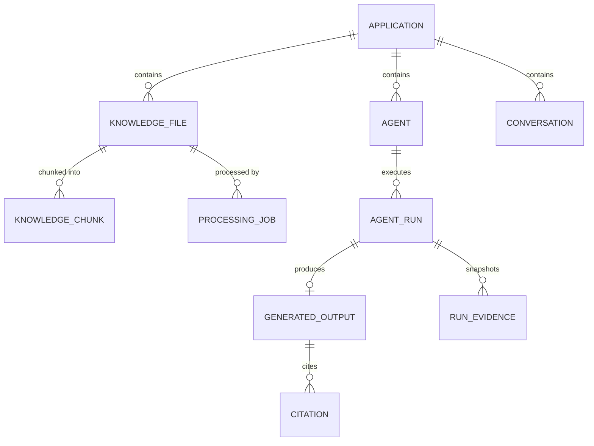

Notable design choices:

- **Snapshots:** an `AgentRun` captures the agent name, prompt, deployment, and
  parameters at submission; a `Conversation` snapshots its retrieval/generation
  settings at creation. Results stay reproducible even if the agent is later edited.
- **Immutable outputs:** `GeneratedOutput` stores both the original Markdown and an
  editable current copy; edits never overwrite the original.
- **Soft deletes:** applications, knowledge files, and conversations preserve
  history rather than hard-deleting, so outputs remain referenceable.
- **Embeddings:** stored as `vector(1536)` with a full-text index enabling hybrid
  (semantic + keyword) retrieval.

---

## Background processing

Async work uses a transactional outbox, SQS queues with dead-letter queues, and
idempotent workers.

- **Queues:** `document-processing`, `agent-execution`, `deletion-jobs`, each with a
  `-dlq` and a redrive policy after `MaxReceiveCount` (default 5).
- **Idempotency:** workers claim jobs with a lease and renew it via heartbeat
  (visibility timeout 60s, heartbeat ~20s). If a worker crashes, the
  `LeaseReaperService` recovers the lease and `JobReconcilerService` re-drives
  stuck work.
- **Progress:** relayed to the API's internal endpoint and broadcast over SignalR.

### Ingestion flow

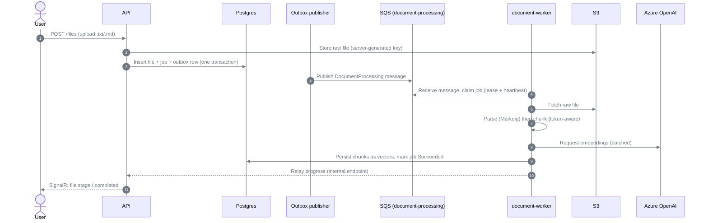

### Agent run flow

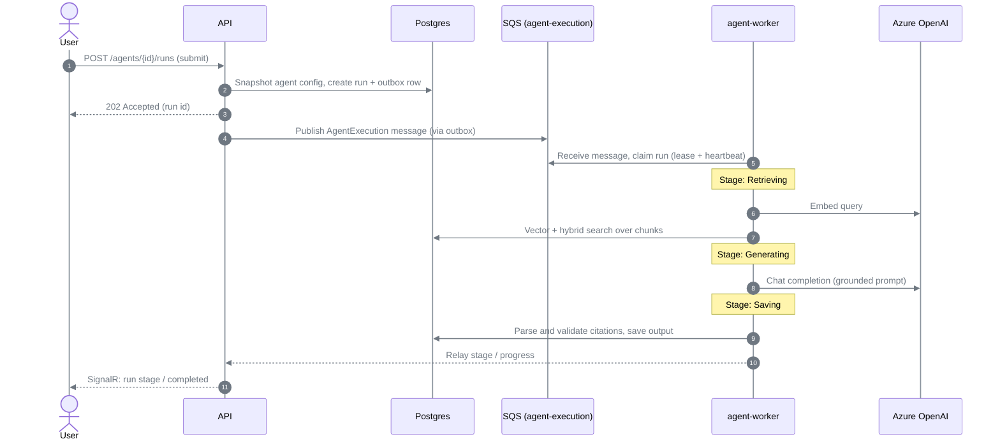

---

## Security

This build targets local development. Do not treat it as production-hardened.

> **No end-user authentication.** There is no login. Every API call runs as a
> single hardcoded actor, `local-user`. The frontend capability hook is a stub that
> grants all capabilities. Requirements documents describe Keycloak-based auth and
> roles; that is **Planned**, not implemented.

What *is* enforced today:

- **Application isolation:** cross-application access is rejected (returns 404).
- **Read-only-state guards:** archived/deleted applications reject mutations.
- **Security headers:** the API sets `X-Content-Type-Options: nosniff`,
  `X-Frame-Options: DENY`, `Referrer-Policy: strict-origin-when-cross-origin`, and a
  strict CSP; the frontend nginx config also applies a strict CSP.
- **Secret handling:** Azure OpenAI keys are never returned to the frontend; secrets
  are kept out of logs, audit records, and error responses. Keys belong in
  `dotnet user-secrets` (or a real secret store), never in `.env` or source. CI runs
  a gitleaks secret scan.
- **Internal relay boundary:** the workers-to-API progress endpoint requires a
  shared-secret `X-Internal-Token`.
- **Object keys** for uploaded files are server-generated (never client-supplied).

### Trust boundaries

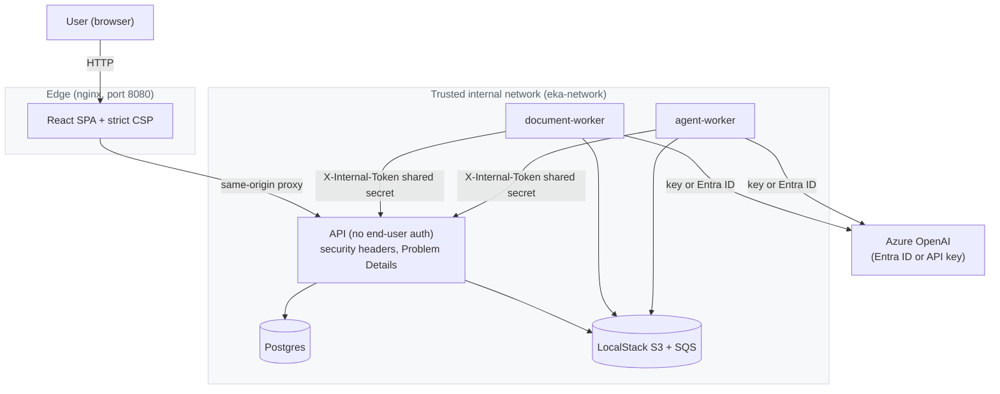

---

## Health and operations

- **Liveness:** `GET /health/live` (process responsiveness only).
- **Readiness:** `GET /health/ready` (checks Postgres, object storage, message
  queue, and worker heartbeats). Azure OpenAI is intentionally excluded — check it
  on demand via `GET /api/operations/aoai-health` to avoid burning model quota.
- **Operations view:** the **Operations** page (and `GET /api/operations/health`)
  shows component health, worker heartbeats, and approximate SQS queue depths
  (including dead-letter counts).
- **Logs:** `docker compose logs -f <service>`. Backend logs are structured
  (Serilog) and enriched with the correlation id; OpenTelemetry metrics/traces
  export to the console (no collector required locally).


---

## Testing

All test commands below are run in CI ([.github/workflows/ci.yml](.github/workflows/ci.yml)).

### Backend

From the repository root:

```powershell
dotnet build EnterpriseKnowledgeAgent.slnx
dotnet test EnterpriseKnowledgeAgent.slnx
dotnet format EnterpriseKnowledgeAgent.slnx --verify-no-changes   # drop the flag to auto-fix
```

- Unit test projects live under `tests/unit` (Api, Application, Architecture,
  Domain, Shared).
- Integration tests (`tests/integration`) use **Testcontainers** to spin up a real
  `pgvector` Postgres and a LocalStack fixture, so **Docker must be running** for
  `dotnet test` to pass those projects.
- `tests/security` and `tests/end-to-end` exist as placeholders and are currently
  empty.

### Frontend

From `src/frontend`:

```powershell
npm ci
npm run lint
npm run typecheck
npm run format:check      # or: npm run format  (to auto-fix)
npm test                  # Vitest + Testing Library
npm run build
```

---

## Troubleshooting

| Symptom | Likely cause | Resolution | Retry safe? |
| --- | --- | --- | --- |
| A service shows `unhealthy` in `docker compose ps` | Dependency still starting or crashed | Inspect `docker compose logs -f <service>`; wait for `postgres`/`localstack` to become healthy first | Yes |
| Migrate script says "No EF Core DbContext found yet" | Old checkout without the EF Design reference | Not applicable to the current build (it applies migrations). Ensure you pulled the latest code | Yes |
| `dotnet ef database update` cannot reach Postgres | Diagnostics profile not running | `docker compose --profile diagnostics up -d`, then re-run the migrate script | Yes |
| Buckets/queues missing after startup | LocalStack init only runs on a fresh volume | Recreate the volume (see below), or run the init script inside the container | Yes |
| Ingestion/agent runs fail immediately | No real Azure OpenAI endpoint/deployments configured | Set `AZURE_OPENAI_*` in `.env` (and the key in user-secrets if using `apikey`); verify with the connectivity script | Yes |
| Run fails with `RetrievalEmpty` | Strict grounding is on and no evidence matched | Upload/enable relevant knowledge, lower `MinimumSimilarity`, or relax strict grounding on the agent; failed runs are retry-eligible | Yes |
| `az` connectivity check fails with `AADSTS50076` | Azure CLI session needs fresh interactive MFA | `az login`, then re-run the script | Yes |
| Docker CLI commands hang with no output | Docker Desktop is unresponsive | Restart Docker Desktop; the stack's running containers are unaffected | Yes |

**Full reset (containers + data volumes):**

```powershell
docker compose down -v
docker compose up -d --build
```

`docker compose down -v` reliably removes only *anonymous* volumes. If the named
volumes retain stale data, remove them explicitly (confirm names with
`docker volume ls` first):

```powershell
docker compose down
docker volume rm enterprise-knowledge-agent_eka-postgres-data enterprise-knowledge-agent_eka-localstack-data
docker compose up -d --build
```

---

## Development workflow

- **Install/build:** `dotnet build EnterpriseKnowledgeAgent.slnx`; in
  `src/frontend`, `npm ci`.
- **Run local checks (mirror CI) before pushing:** backend `dotnet test` +
  `dotnet format --verify-no-changes`; frontend `npm run lint`, `npm run typecheck`,
  `npm run format:check`, `npm test`, `npm run build`.
- **Change the database:** add an EF Core migration under `src/infrastructure`, then
  apply it with `./deploy/postgres/migrate.ps1` (diagnostics profile up).
- **Add an API endpoint:** create/extend an `*Endpoints.cs` group in `src/api`, back
  it with an application service, and mirror the DTO in the frontend `src/api`
  client.
- **Add a background job:** define the message contract in `src/shared`, publish via
  the outbox, and handle it in the relevant worker.
- **Add a UI feature:** add a route/page under `src/frontend/src`, wire data through
  a TanStack Query hook, and add a Vitest test under `src/frontend/src/test`.

---

## Deployment

The only verified, supported runtime is **local Docker Compose** (see
[Running the project](#running-the-project)). CI additionally validates that all
four service images (`api`, `agent-worker`, `document-worker`, `frontend`) build.

There are no production deployment manifests (no Kubernetes/Helm/Terraform) in this
repository, and production concerns — real authentication, TLS, managed secrets,
scaling — are out of scope for the current build.

> Documentation pending: a production deployment procedure could not be verified
> from the current repository.

---

## Backup and restore

`deploy/postgres/` includes `backup.ps1`/`backup.sh` and `restore.ps1`/`restore.sh`
alongside the migrate scripts, plus a `deploy/postgres/backups/` directory.

> Documentation pending: these scripts were not executed during this documentation
> pass, so their exact behavior and options are not described here. Review the
> script headers before relying on them, and treat `restore` as destructive to the
> target database.

---

## Accessibility

The SPA builds on Radix UI / shadcn primitives, which provide semantic roles and
keyboard interaction (dialogs, menus, tabs, the command palette via `⌘/Ctrl-K`).
Status is conveyed with both icon and text (not color alone), and dark/light themes
are supported with a header toggle. Formal accessibility testing/audits are not part
of this repository.

---

## Known limitations

- **No authentication or real user identity** — single `local-user` actor; roles
  are conceptual only.
- **Azure OpenAI required** for ingestion/generation; without it the UI runs but AI
  actions fail at call time.
- **File types** limited to `.txt` and `.md`; no PDF/DOCX/image/audio/video.
- **No export feature** yet (the `rag-generated-exports` bucket is provisioned but
  unused).
- **Single LLM provider**, no fallback, no cache/Redis, no dedicated vector DB.
- **Migrations are manual** (not auto-applied at startup).
- **No production deployment path**; local Compose only.
- **`tests/security` and `tests/end-to-end` are empty** placeholders.
- **No git history** in this checkout and **no license file** (see below).

---

## Contributing

There is no `CONTRIBUTING.md` in the repository. In its absence, follow the checks
that CI enforces:

1. Keep changes green locally: run the full backend and frontend check suites in
   [Testing](#testing) before opening a pull request.
2. Match existing formatting (`dotnet format`, Prettier) and linting (ESLint).
3. Add or update tests for behavior you change.
4. Never commit secrets; CI runs a gitleaks scan and it will fail the build.

CI runs on pushes and pull requests to the `main` branch.

---

## License

> Documentation pending: no `LICENSE` file is present in the repository, so the
> licensing terms could not be verified. Do not assume any particular license until
> one is added by the maintainers.

---

## Support

There is no dedicated support channel documented in the repository. Use the
project's issue tracker for questions and bug reports. For design intent and
requirements, consult the documents in [`docs/`](docs/).

---

## Documentation index

- [docs/Architecture and Solution Design Document.md](docs/Architecture%20and%20Solution%20Design%20Document.md) — full solution design.
- [docs/Functional Requirements Document.md](docs/Functional%20Requirements%20Document.md) — functional requirements (note: some items are Planned, not built).
- [docs/tasks.md](docs/tasks.md) — engineering backlog (contains superseded decisions).
- [docs/readme-analysis.md](docs/readme-analysis.md) — how this README was verified, including documentation conflicts.
- [docs/screenshots/README.md](docs/screenshots/README.md) — screenshot inventory and capture standards.
- [docs/diagrams/](docs/diagrams/) — editable Mermaid diagram sources.
- [deploy/localstack/init/README.md](deploy/localstack/init/README.md) — LocalStack bucket/queue provisioning.
