# Enterprise Knowledge Agent — User Manual

**Manual version:** 1.0
**Application version:** local development build (no released version tag; this
repository has no version file or git tags)
**Last reviewed:** 2026-08-18
**Intended audience:** first-time and experienced users of the Enterprise
Knowledge Agent web application
**Documentation status:** verified against the running application at
`http://localhost:8080` and the frontend source in `src/frontend`.

---

## About This Manual

This manual teaches you to use the Enterprise Knowledge Agent web application from
first open to confident, expert use. It explains every page you can reach, every
control you will use, the workflows that tie them together, what each status
means, and how to recover when something goes wrong.

**How the manual is organized.** Start with [Product Overview](#product-overview)
and [Getting Started](#getting-started). Then read [Application
Layout](#application-layout) and [Navigation](#navigation) to orient yourself.
The [Module Guides](#module-guides) walk through each area of the app in the order
you will naturally use it. Reference sections at the end cover
[statuses](#status-and-progress-reference), [errors](#error-recovery),
[troubleshooting](#troubleshooting), [FAQ](#frequently-asked-questions), and a
[glossary](#glossary).

**Status labels used in this manual:**

- **Available:** implemented and verified in the running application.
- **Partial:** some behavior exists, but the complete workflow is not available.
- **Planned:** designed or documented but not implemented.
- **Unavailable:** not supported in the current application.
- **Unverified:** could not be confirmed from the application or repository.

> **Important:** The design documents in this repository describe features — most
> notably user login and roles — that are **not** in the current application. This
> manual documents what the running application actually does and clearly labels
> anything that is Planned or could not be verified.

**How to interpret screenshots.** All screenshots show the actual running
application in its dark theme at a 1440×1000 window, using demonstration data (an
application named **Test**, an agent named **List Tasks**, and a knowledge file
named `tasks.md`). Your data will differ. Screenshots are aids; every step is
written so you can follow it without the image.

---

## Product Overview

Enterprise Knowledge Agent is a **retrieval-augmented generation (RAG)** platform.
You give it your documents, and it answers questions that are grounded in those
documents, showing the evidence and citations behind each answer.

**What it does**

- Organizes work into isolated **applications**.
- Ingests `.txt` and `.md` **knowledge files** and turns them into a searchable
  index.
- Lets you build **agents** — reusable assistants defined by a prompt plus
  generation and retrieval settings.
- **Runs** agents against a request, or lets you **chat** against the knowledge,
  producing grounded Markdown **outputs** with **citations**.
- Surfaces processing progress, run stages, dashboards, and audit activity in real
  time.

**Problems it solves.** It provides a controlled way to ask questions of a body of
documents and get answers that are traceable to their sources, rather than
free-form model output with no provenance.

**Main workflow**

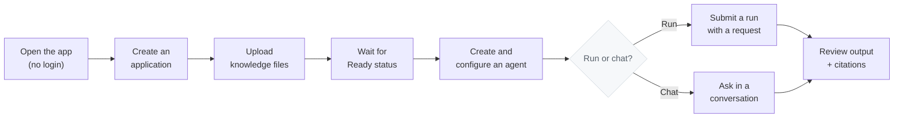

**Current scope.** The application focuses on this single, complete path. It does
not (yet) support other file types, exports, multiple AI providers, or user
accounts. See [Known Limitations](#known-limitations).

---

## Getting Started

### Prerequisites

- The application stack must be running and reachable at **http://localhost:8080**
  (see the project [README](../README.md) for how to start it).
- For document processing and answer generation to succeed, the stack must be
  connected to a working **Azure OpenAI** resource. Without it, the interface
  still works, but uploads stay unprocessed and runs fail. See
  [Troubleshooting](#troubleshooting).

### Access requirements

**There is no login.** The application does not have accounts, passwords, or a
sign-in screen. Opening the URL gives you immediate, full access. Every action you
take is recorded against a single built-in user named `local-user`.

> **Important:** Because there is no authentication, anyone who can reach the URL
> has full access to every application and every action, including deletion. Treat
> the environment accordingly. Roles described in [User Roles and
> Permissions](#user-roles-and-permissions) are **Planned**, not active.

### Supported platforms

The application is a browser single-page app. Use a current desktop browser
(Chromium-based browsers such as Chrome or Edge are the reference). A viewport of
about 1280 px wide or more is recommended; the layout adapts to narrower widths and
exposes a menu button for the sidebar on small screens.

### First open

1. Open **http://localhost:8080** in your browser.
2. You arrive at the **Platform → Dashboard** page.
3. If the top of the page shows **Live updates connected** and **All systems
   operational**, the application is healthy and ready.

There is no logout because there is no login. To end a session, close the browser
tab.

### Recommended browser settings

- Allow the site to use WebSocket connections (used for live updates); no special
  configuration is normally needed on `localhost`.
- Keep the default theme, or switch it any time with the theme toggle in the
  header (see [Application Layout](#application-layout)).

---

## User Roles and Permissions

> **Important (verified behavior).** In the current application there is **one
> effective role with full access**. The capability system that would restrict
> actions by role is present in the code but is a stub that grants **all**
> capabilities, and there is no login to assign roles. The role names and matrix
> below are **Planned** and are included only to explain the intended model and the
> "Allow viewers to run agents" setting you will see on applications.

### Planned roles

| Role | Intended scope | Intended abilities |
| --- | --- | --- |
| SuperAdmin | Platform-wide | Everything: manage applications, knowledge, agents, runs, outputs; view audit and operations |
| SuperViewer | Platform-wide | Read-only across the platform, including audit and operations |
| ApplicationAdmin | One application | Manage that application's knowledge, agents, runs, and outputs |
| ApplicationViewer | One application | View results; may run agents only if the application enables it |

### What is enforced today

Even without roles, the server still enforces two protections you may notice:

- **Application isolation:** you cannot access one application's data through
  another application's URL; such requests return "not found".
- **Read-only state:** an **Archived** or **Deleted** application rejects changes.
  You must **Restore** an archived application before editing it again.

The **Allow viewers to run agents** checkbox on an application is stored and shown,
but because there are no roles in this build, it has **no runtime effect** here.

---

## Application Layout

Every page shares the same frame: a left **sidebar**, a top **header**, and the
main **content area**.

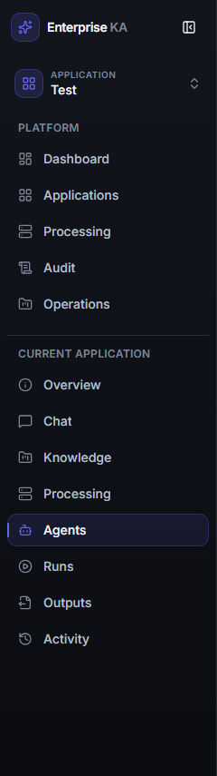

### Annotated overview

The dashboard below is annotated to show the persistent layout regions. The
numbered callouts are explained under the image.

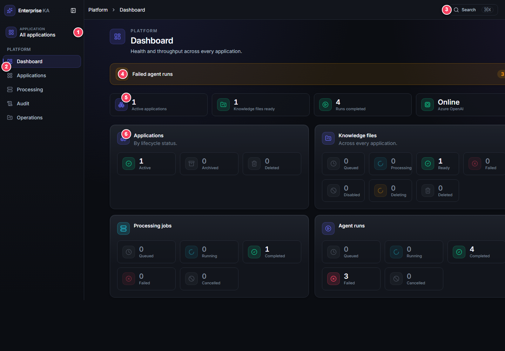

1. **Application switcher** — shows the current context ("All applications" or a
   specific application) and lets you change it.
2. **Sidebar navigation** — grouped links to every page (see
   [Navigation](#navigation)).
3. **Search / command palette** — opens the command palette; keyboard shortcut
   `Ctrl+K` (`⌘K` on macOS).
4. **Attention banner** — appears when something needs attention (for example,
   failed agent runs), with a count.
5. **Metric tiles** — headline numbers for the current page.
6. **Section cards** — grouped detail below the headline metrics.

### Header elements

From the header you can, at any time:

- Open the **command palette** with the **Search** button or `Ctrl+K`.
- See the **live-updates indicator** ("Live updates connected", "Connecting to live
  updates…", or a reconnecting state) — this reflects the real-time connection that
  keeps lists current without refreshing.
- See the **health indicator** ("All systems operational" or "Health status
  unknown").
- Read the **breadcrumbs** showing where you are, and click them to go back up.
- Toggle the **theme** between dark and light with the theme button.

> **Note:** The live-updates and health indicators convey status with an icon and
> text, not color alone, so they remain clear in both themes.

### Responsive behavior

On narrow screens the sidebar collapses behind a **menu** button at the top-left of
the header. On wide screens you can collapse the sidebar to icons with the
**Collapse sidebar** control; hover a collapsed icon to see its label.

---

## Navigation

The sidebar has two groups. The **PLATFORM** group is always present. The **CURRENT
APPLICATION** group appears only after you open an application.

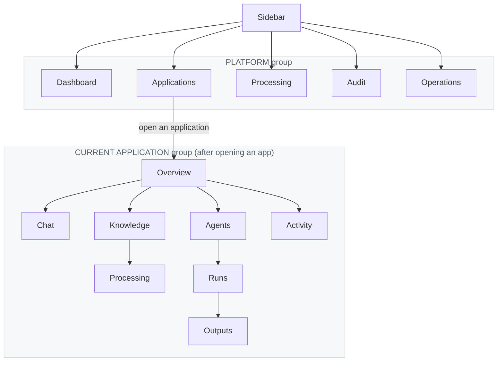

**PLATFORM group**

| Item | Goes to | Purpose |
| --- | --- | --- |
| Dashboard | `/platform/dashboard` | Cross-application health and throughput |
| Applications | `/platform/applications` | Create and manage applications |
| Processing | `/platform/processing` | Every document-processing job, all applications |
| Audit | `/platform/audit` | Platform-wide audit log |
| Operations | `/platform/operations` | Component health, workers, queues, Azure OpenAI check |

**CURRENT APPLICATION group** (Overview, Chat, Knowledge, Processing, Agents, Runs,
Outputs, Activity) links to that application's pages. Note that **Activity** is the
application's own audit log; there is no separate "Audit" item inside an
application.

**Changing context.** Open an application from the **Applications** page (or the
application switcher) to reveal its group. To leave it, choose any PLATFORM item or
switch to "All applications" in the switcher.

**Command palette.** Press `Ctrl+K` (`⌘K`) anywhere to jump to actions and pages
without hunting through the sidebar. See [Command palette](#command-palette).

**Browser navigation.** Back/forward and bookmarking work normally because each
page has its own URL. It is safe to bookmark a specific application page.

---

## Dashboard

**Purpose.** The Platform Dashboard is your at-a-glance view of activity across
every application: how many applications are active, how much knowledge is ready,
how many runs completed, whether Azure OpenAI is reachable, and the current state
of processing jobs and agent runs. It also raises **attention items** when
something needs a look.

**Who can open it.** Everyone (it is the landing page). **How to open it:** it is
the default page, or select **Dashboard** under PLATFORM.

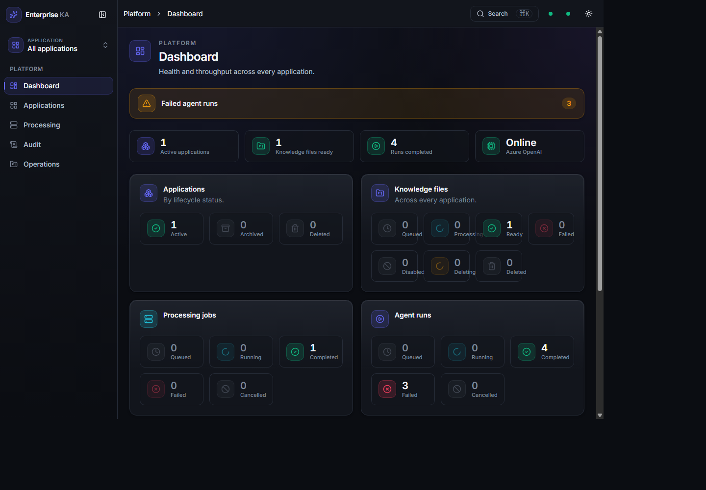

**Page regions**

- **Attention banner(s)** at the top — for example, "Failed agent runs" with a
  count — appear only when there is something to address.
- **Headline metric tiles** — Active applications, Knowledge files ready, Runs
  completed, and Azure OpenAI status (**Online** / **Offline**).
- **Section cards** — Applications by lifecycle status; Knowledge files by status;
  Processing jobs by status; Agent runs by status; Workers (heartbeats); Queues
  (approximate depth and dead-letter counts).

**Status indicators.** Every count uses the shared status styling (icon plus text).
Zero values are dimmed so the numbers that need attention stand out. See the
[Status and Progress Reference](#status-and-progress-reference).

**Refresh behavior.** The dashboard updates itself through the live connection; you
do not need to refresh the page. If the header shows the connection is
reconnecting, values may briefly lag.

**Related pages:** [Operations](#operations) for deeper health,
[Processing](#processing) for the job queue, and each application's own dashboard
via its [Overview](#application-overview).

---

## Module Guides

Each guide covers one area: its purpose, who can use it, how to open it, the page
layout and controls, the workflows, the statuses you will see, and how to recover
from failures. Because the current build has one full-access role, "who can use it"
is "any user" unless stated; Planned role restrictions are noted where relevant.

### Applications

**Purpose.** An **application** is an isolated workspace that groups its own
knowledge files, agents, runs, and outputs. You create one application per body of
knowledge or use case. The **Applications** page lists every application and is
where you create, edit, archive, restore, or delete them.

**Who can use it.** Any user (Planned: SuperAdmin creates; others view).
**How to open it:** select **Applications** under PLATFORM.

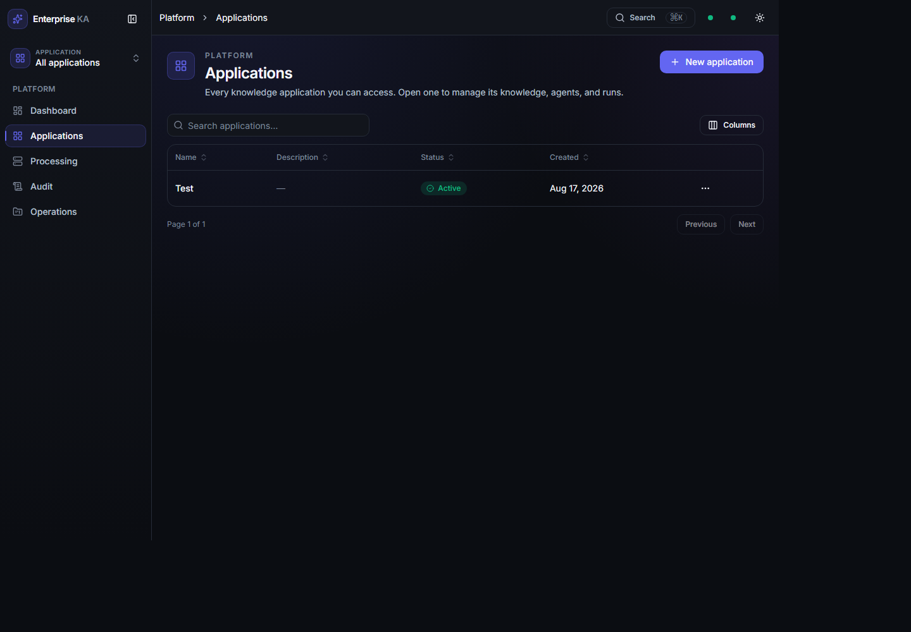

**Page layout**

- **New application** button (top-right) opens the create dialog.
- A **search** box filters the list by name.
- A **Columns** button toggles which columns are shown.
- A sortable **table** with columns Name, Description, Status, Created, and a
  per-row **Row actions** menu.
- **Previous / Next** pagination below the table.

**Statuses shown:** **Active**, **Archived**, **Deleted** (see
[Status and Progress Reference](#status-and-progress-reference)).

#### Workflow: Create an application

**Purpose:** create a new isolated workspace.
**Who can perform it:** any user (Planned: SuperAdmin).
**When to use it:** before uploading knowledge or building agents for a new use
case.
**Prerequisites:** none.
**Starting point:** the **Applications** page.

**Steps:**

1. Select **New application**. The **Create application** dialog opens.
2. In **Name** (required), enter a clear name, for example `Contract Review`. The
   field accepts up to 200 characters.
3. Optionally, in **Description**, add context (up to 2000 characters). This is
   shown in the list.
4. Optionally, enable **Allow viewers to run agents**. Its help text reads: "When
   enabled, ApplicationViewers may submit agent runs, not just view results."
5. Select **Create**.

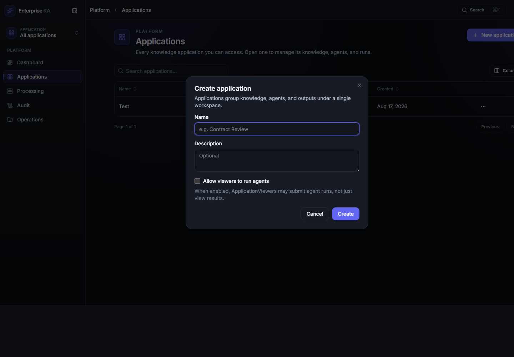

**What the system does:** it creates the application in **Active** status,
attributed to `local-user`, and records an audit event.

**Expected result:** the dialog closes, a **"Application created"** confirmation
appears, and the new row appears in the list.
**How to verify success:** the application is listed with status **Active**.
**Alternative paths:** select **Cancel** (or **Close**) to abandon the dialog.
**Errors and recovery:** if **Name** is empty you see "Name is required"; if it is
too long, "Name is too long". Fix the field and select **Create** again. A server
error shows "Failed to create application"; retry is safe.
**Permissions and security:** the **Allow viewers to run agents** setting is stored
but has no effect in this build (no roles). See [Roles](#user-roles-and-permissions).
**Best practices:** use a descriptive name; keep one application per distinct body
of knowledge so retrieval stays focused.
**Related workflows:** [Upload knowledge files](#workflow-upload-knowledge-files),
[Create an agent](#workflow-create-an-agent).

#### Workflow: Edit, archive, restore, or delete an application

**Purpose:** manage an application's lifecycle.
**Who can perform it:** any user (Planned: SuperAdmin).
**When to use it:** rename/redescribe (Edit); take out of active use but keep data
(Archive); return to use (Restore); remove from use while preserving historical
outputs (Delete).
**Prerequisites:** the application exists. Editing requires the application to be
**Active** (archived/deleted applications are read-only).
**Starting point:** the **Applications** page, **Row actions** menu.

**Steps:**

1. Open the **Row actions** menu on the application's row.
2. Choose one:
   - **Edit** — opens the **Edit application** dialog; change **Name**,
     **Description**, or the viewer-execution setting, then select **Save changes**.
   - **Archive** — confirm in "Archive application?" ("… becomes read-only for
     other modules until restored."); select **Archive**.
   - **Restore** (shown for archived apps) — confirm "Restore application?"; select
     **Restore**.
   - **Delete** — confirm "Delete application?" ("… will be soft-deleted. Historical
     outputs remain viewable, but the application can no longer be used."); select
     **Delete**.

**What the system does:** updates the application's status (or fields) and records
an audit event. Delete is a **soft delete** — historical outputs remain viewable.

**Expected result / verify success:** a confirmation toast ("Application updated",
"Application archived", "Application restored", or "Application deleted") and the
row's status changes accordingly.
**Errors and recovery:** a failure toast ("Failed to …") means the change did not
apply; retry is safe. Editing an archived application is blocked — **Restore** it
first.

> **Warning:** **Delete** and **Archive** affect everyone (there is no per-user
> view). Deleted applications can no longer be used, though their past outputs
> remain viewable. Use **Archive** if you might need the application again.

**Related workflows:** all application-scoped workflows below.

---

### Application Overview

**Purpose.** The **Overview** is the home page of an application. It summarizes the
application (name, description, settings) and presents the end-to-end **workflow
pipeline** so you can see, and jump into, each stage from knowledge to outputs.

**Who can use it.** Any user with access to the application.
**How to open it:** open an application (from **Applications** or the switcher);
you land on **Overview**, or select **Overview** in the CURRENT APPLICATION group.

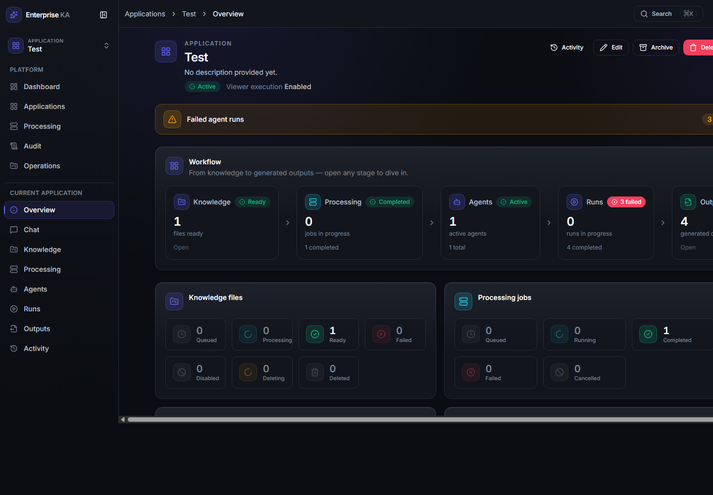

**Page layout**

- A header with the application name and status.
- A **Workflow** section that visualizes the stages (knowledge → processing →
  agents → runs → outputs); open any stage to go straight to it.
- Summary cards for knowledge files, processing jobs, and agent runs (the same
  status groupings as the platform dashboard, scoped to this application).

**Refresh behavior:** updates live through the real-time connection.
**Related pages:** [Knowledge](#knowledge), [Agents](#agents), [Runs](#runs),
[Outputs](#outputs).

---

### Knowledge

**Purpose.** Knowledge files are the documents your agents draw on. The
**Knowledge** page lists an application's files, lets you upload new ones, and lets
you manage each file (preview, disable/enable, reprocess, replace, delete). Only
files in **Ready** status and enabled for retrieval are searched.

**Who can use it.** Any user (Planned: SuperAdmin/ApplicationAdmin manage; others
view). **How to open it:** in an application, select **Knowledge**.

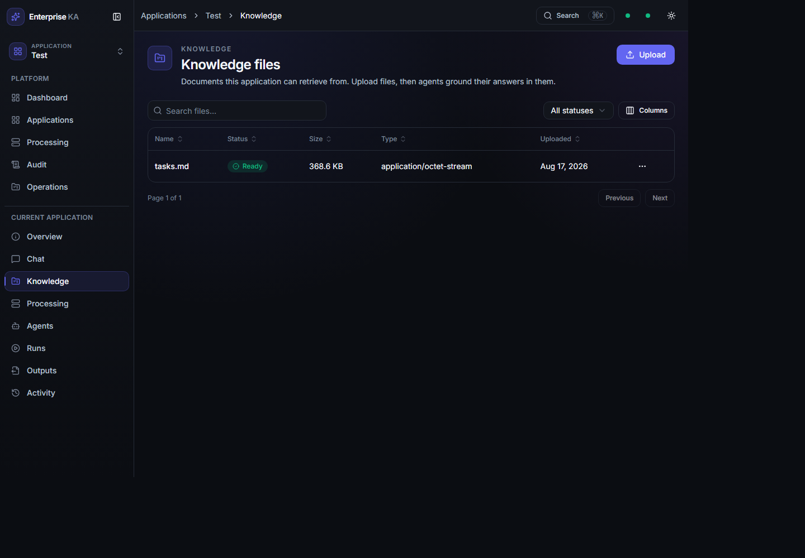

**Page layout**

- **Upload** button (top-right) opens the upload dialog.
- **Search** box (filters by file name) and a **status filter** ("All statuses" by
  default).
- A **Columns** button and a sortable **table** with Name, Status, Size, Type,
  Uploaded, and a per-row actions menu.
- **Previous / Next** pagination.

**Statuses shown:** **Queued**, **Processing** (with a percentage while running),
**Ready**, **Failed**, **Disabled**, **Deleting**, **Deleted**. See the
[Status and Progress Reference](#status-and-progress-reference) and the lifecycle
diagram in [Background processing](#how-processing-works).

#### Workflow: Upload knowledge files

**Purpose:** add documents an application can retrieve from.
**Who can perform it:** any user (Planned: SuperAdmin/ApplicationAdmin).
**When to use it:** before creating or running an agent, and whenever you have new
source material.
**Prerequisites:** an existing application; `.txt` or `.md` files up to **10 MiB**
each.
**Starting point:** the **Knowledge** page.

**Steps:**

1. Select **Upload**. The **Upload knowledge files** dialog opens ("Add one or more
   text/markdown files. Each file is validated and processed independently.").
2. Select **Choose files** ("Click to browse for text or markdown files") and pick
   one or more `.txt`/`.md` files.
3. Review the selected list; remove any file with its **Remove** control if needed.
4. Select **Upload (N)**, where N is the number of files.

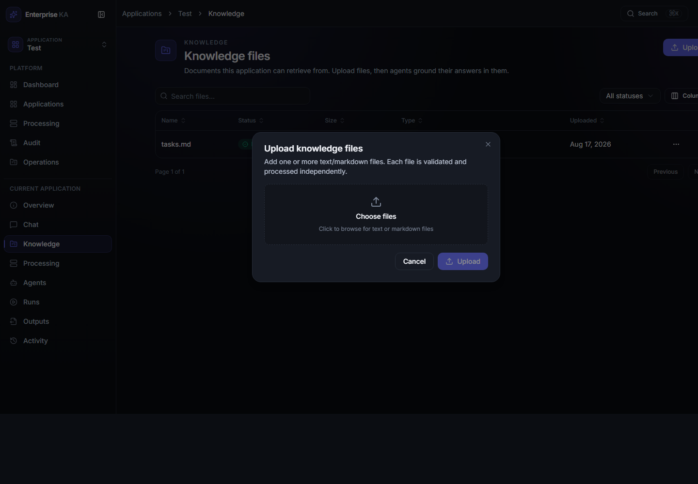

**What the system does:** each file is validated (type, size, and duplicate
content) and stored; a processing job is queued to parse the file, split it into
chunks, generate embeddings, and index them for retrieval. Files are handled
independently, so one rejection does not block the others.

**Expected result:** a summary appears (for example, "5 file(s) uploaded", or "3
accepted, 2 skipped — see details in the dialog"), and each new file appears in the
table, moving from **Queued** to **Processing** to **Ready**.
**How to verify success:** the file reaches **Ready**. Only then can agents
retrieve from it.
**Alternative paths:** re-uploading identical content is detected as a duplicate;
the per-file result explains the outcome.
**Errors and recovery:** files that are the wrong type or too large are reported
per file (for example, a size-limit reason). A general failure shows "Failed to
upload files"; retry is safe. If a file reaches **Failed** during processing, use
**Reprocess** (below).
**Permissions and security:** files are stored server-side with server-generated
keys; you never handle storage locations directly.
**Best practices:** prefer well-structured Markdown (headings help chunking and
citations); upload related material together so retrieval has the context it needs.
**Related workflows:** [Manage a knowledge file](#workflow-manage-a-knowledge-file),
[Create an agent](#workflow-create-an-agent).

#### Workflow: Manage a knowledge file

**Purpose:** control whether and how a file is used, or remove it.
**Who can perform it:** any user (Planned: SuperAdmin/ApplicationAdmin).
**When to use it:** to exclude a file temporarily (**Disable**), re-include it
(**Enable**), rebuild its chunks after a change or failure (**Reprocess**), swap its
content (**Replace**), or remove it (**Delete**).
**Prerequisites:** the file exists; some actions depend on current status (for
example, **Reprocess** applies to **Ready** or **Failed** files).
**Starting point:** the **Knowledge** page row actions, or the file's detail page.

**Steps:** open the row actions (or open the file), then choose:

- **Disable** — confirm "Disable file?" ("… is excluded from retrieval but remains
  visible to admins."); select **Disable**.
- **Enable** — confirm "Enable file?"; select **Enable**.
- **Reprocess** — confirm "Reprocess file?" ("… will be re-processed from its
  original source; prior chunks will be regenerated."); select **Reprocess**.
- **Delete** — confirm "Delete file?" ("… will be deleted. Historical outputs remain
  viewable, but its content will no longer be retrievable."); select **Delete**.

**What the system does:** Disable/Enable flip the file's retrieval eligibility;
Reprocess re-queues processing and regenerates chunks; Delete marks the file
**Deleting** and asynchronously removes its stored content, ending in **Deleted**.

**Expected result / verify success:** a confirmation toast ("File disabled",
"File enabled", "File queued for reprocessing", or "File deleted") and the row's
status updates. Reprocessing moves the file back through **Queued/Processing** to
**Ready**.
**Errors and recovery:** a "Failed to …" toast means the action did not apply;
retry is safe. Deletion is asynchronous — the row shows **Deleting** briefly.

> **Warning:** **Delete** removes the file's content from future retrieval. Past
> outputs that cited it remain viewable, but the source can no longer be opened for
> new evidence. Use **Disable** if you only want to exclude it temporarily.

**View a file's details.** Select a file name to open its detail page: metadata
(name, size, type, uploaded date, processing stage), a text **preview** when the
file is **Ready**, and the same management actions.

**Related pages:** [Processing](#processing).

---

### Processing

**Purpose.** Processing pages show the background jobs that turn uploaded files into
searchable knowledge (parsing, chunking, embedding). Use them to watch progress and
diagnose stuck or failed jobs. There are two scopes: **platform** (all
applications) and **per application**.

**Who can use it.** Platform Processing is Planned for SuperAdmin/SuperViewer; in
this build any user can open it. **How to open it:** **Processing** under PLATFORM,
or **Processing** in the CURRENT APPLICATION group.

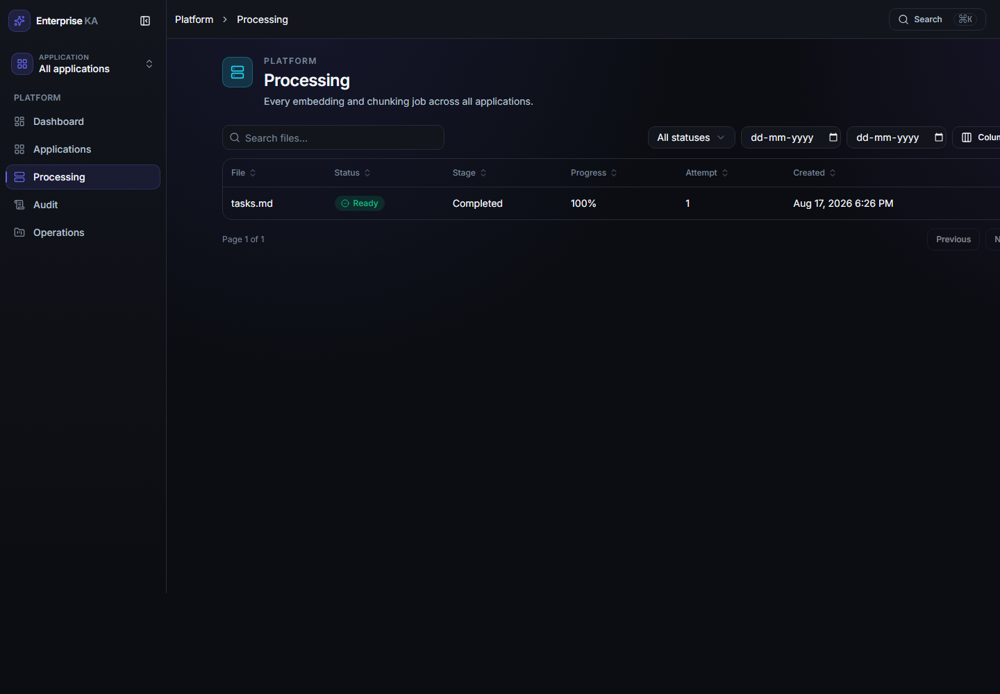

**Page layout**

- **Search** box (by file), a **status filter**, and **Created from / Created to**
  date filters.
- A sortable **table**: File, Status, Stage, Progress, Attempt, Created. Selecting a
  row opens the job detail.
- **Previous / Next** pagination.

**Statuses shown:** **Queued**, **Processing** (Running), **Ready** (Completed),
**Failed**, plus the **Stage** (for example, Completed) and a **Progress**
percentage. **Attempt** shows how many times the job has run — a value above 1
indicates automatic retries.

**What the system does.** Jobs are processed by background workers that claim a job,
work through its stages, and report progress live. Failed jobs may be retried
automatically; persistent failures stop after a set number of attempts. See
[How processing works](#how-processing-works).

**Recovery.** If a document ends **Failed**, open the file on the
[Knowledge](#knowledge) page and choose **Reprocess**. If many jobs stall, check
[Operations](#operations) for worker and queue health and confirm Azure OpenAI is
reachable.

**Related pages:** [Knowledge](#knowledge), [Operations](#operations).

---

### Agents

**Purpose.** An **agent** is a reusable, configured assistant: a prompt plus
generation settings (which model, how creative, how long) and retrieval settings
(how it searches the knowledge). You create an agent once and run it many times.

**Who can use it.** Any user (Planned: SuperAdmin/ApplicationAdmin manage).
**How to open it:** in an application, select **Agents**.

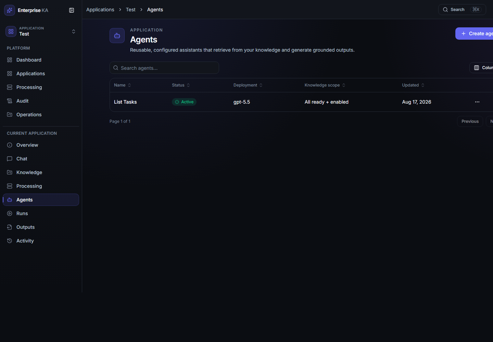

**Page layout**

- **Create agent** button (top-right).
- **Search** box, **Columns** button, and a sortable **table**: Name, Status,
  Deployment, Knowledge scope, Updated, plus row actions.
- **Previous / Next** pagination.

**Statuses shown:** **Active**, **Disabled**, **Deleted**.

#### Workflow: Create an agent

**Purpose:** define a new assistant.
**Who can perform it:** any user (Planned: SuperAdmin/ApplicationAdmin).
**When to use it:** once your knowledge files are **Ready** and you want repeatable,
grounded answers.
**Prerequisites:** an application; at least one **chat deployment** configured on
the server (otherwise creation is blocked with a message that an administrator must
configure one).
**Starting point:** the **Agents** page.

**Steps:**

1. Select **Create agent**. The **Create agent** dialog opens ("Give it a name to
   get started — you'll configure the prompt, model, and knowledge scope next.").
2. Enter a **Name** (required, up to 200 characters).
3. Optionally add a **Description** ("What this agent is for — shown in the agent
   list.").
4. Select **Create**.

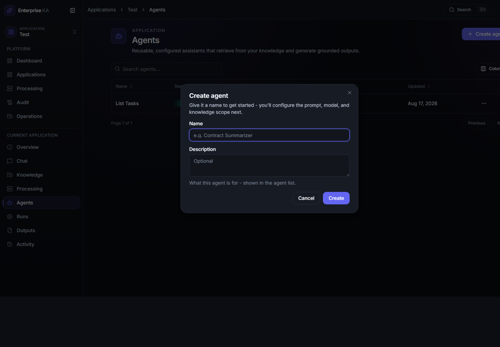

**Expected result:** a **"Agent created — configure it below"** confirmation, and
the agent's detail page opens so you can configure it (next workflow).
**Errors and recovery:** "Name is required" / "Name is too long" — fix and retry.
"Failed to create agent" — retry is safe.
**Related workflows:** [Configure an agent](#workflow-configure-an-agent).

#### Workflow: Configure an agent

**Purpose:** set the prompt and the generation and retrieval behavior.
**Who can perform it:** any user (Planned: SuperAdmin/ApplicationAdmin).
**When to use it:** immediately after creating an agent, or any time you want to
tune it.
**Prerequisites:** the agent exists.
**Starting point:** the agent's detail page (open it from the **Agents** list).

The detail page is annotated below.

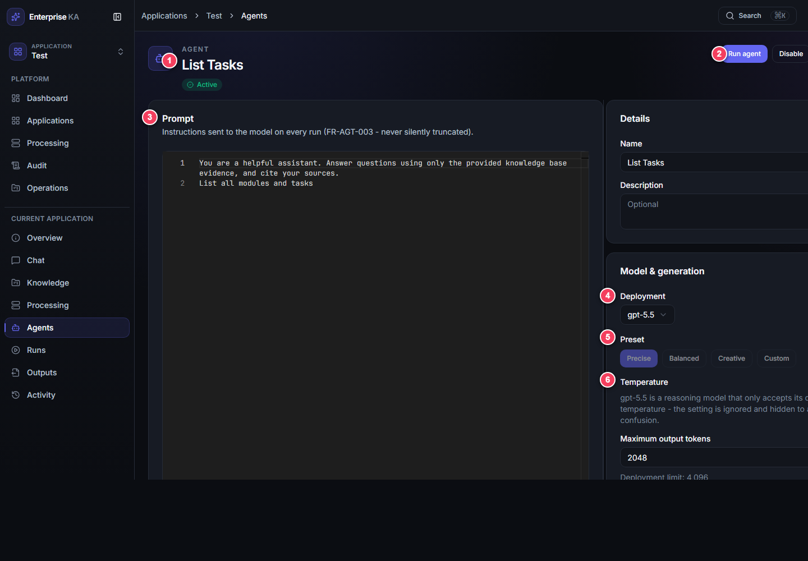

1. **Agent name and status** — with the current **Active/Disabled** badge.
2. **Run agent** — submit a run of this agent (see [Run an
   agent](#workflow-run-an-agent)); **Disable/Enable** and **Delete** are alongside.
3. **Prompt** — the instructions sent to the model on every run. Required; up to
   100,000 characters. This is the single most important setting.
4. **Deployment** — the model used to generate answers, chosen from the configured
   deployments.
5. **Preset** — a quick way to set creativity: **Precise** (temperature 0.2),
   **Balanced** (0.7), **Creative** (1.1), or **Custom**.
6. **Temperature** — fine control (0–1). For "reasoning" models that only accept a
   fixed temperature, this control is hidden and a note explains it is ignored.

**Steps:**

1. Edit the **Prompt** to describe exactly what the agent should do and how to use
   the evidence (for example, "Answer using only the provided knowledge and cite
   your sources.").
2. Choose the **Deployment** and set creativity via **Preset** or **Temperature**.
3. Set **Maximum output tokens** (how long an answer may be; defaults to 2048, and
   is capped by the deployment's limit).
4. Optionally set **Top P** (0–1) for nucleus sampling.
5. Under retrieval, set **Retrieval mode** (**Semantic** or **Hybrid (semantic +
   keyword)**), **Retrieval count** (1–50, default 8), **Minimum similarity** (0–1,
   default 0.35), and **Maximum evidence tokens** (default 4000).
6. Toggle **Include neighbors**, **Strict grounding**, and **Citations required**
   (all on by default).
7. Set **Knowledge scope** — **All ready files** or **Selected files only** (then
   tick the files under "Files to search").
8. Select **Save agent**.

**What the system does:** it stores the configuration as the agent's live settings.
Each run later takes a **snapshot** of these settings, so changing an agent does not
alter the record of past runs.

**Expected result / verify success:** an **"Agent saved"** confirmation; the values
persist when you reopen the agent.
**Errors and recovery:** field validation messages appear inline (for example,
temperature must be 0–2, retrieval count 1–50); fix and save again. "Failed to save
agent" — retry is safe.
**Best practices:**

- Keep **Strict grounding** and **Citations required** on for trustworthy, sourced
  answers.
- Start with **Hybrid** retrieval; raise **Retrieval count** if answers miss
  context, or raise **Minimum similarity** to cut weak matches.
- Lower **Temperature** (Precise) for factual extraction; raise it (Creative) for
  drafting.

> **Note:** With **Strict grounding** on, if retrieval finds no matching evidence
> the run fails with a "no evidence matched" message rather than inventing an
> answer. This is intended — see [Run an agent](#workflow-run-an-agent).

#### Workflow: Enable, disable, or delete an agent

Open the agent's row actions (or its detail page) and choose:

- **Enable** — confirm "Enable agent?"; the agent becomes runnable. Toast: "Agent
  enabled".
- **Disable** — confirm "Disable agent?" ("… can no longer be run until
  re-enabled."); toast "Agent disabled".
- **Delete** — confirm "Delete agent?" ("… will be soft-deleted. Historical outputs
  remain viewable, but it can no longer be run."); toast "Agent deleted".

> **Warning:** A **Disabled** agent cannot be run until re-enabled. **Delete** is a
> soft delete: past outputs remain, but the agent is gone from the runnable list.

**Related pages:** [Runs](#runs), [Outputs](#outputs), [Chat](#chat).

---

### Runs

**Purpose.** A **run** is one execution of an agent against a specific **request**.
The **Runs** page lists executions; each run detail shows the stage-by-stage
progress, the exact configuration used, the evidence retrieved, and a link to the
generated output.

**Who can use it.** Any user (Planned: run submission requires execute permission).
**How to open it:** in an application, select **Runs**.

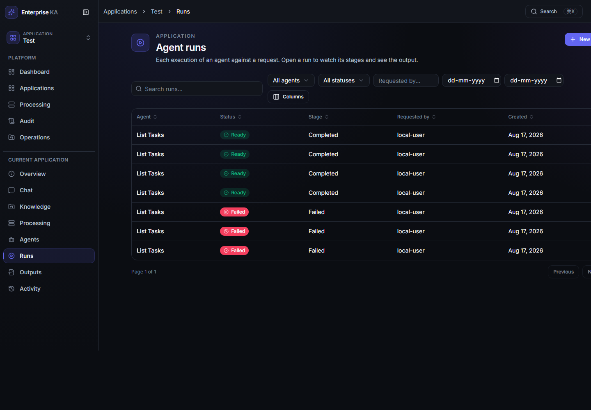

**Page layout**

- **New run** button (top-right).
- Filters: **agent** ("All agents"), **status**, **created-by** text, and a **date
  range** (from/to). A free-text **Search** box.
- A sortable **table**: Agent, Status, Stage, Requested by, Created. Selecting a row
  opens the run detail.

**Statuses shown:** **Queued**, **Running** (shown as Processing), **Completed**
(Ready), **Failed**, **Cancelled** (Disabled). The **Stage** column shows the
current step.

#### Workflow: Run an agent

**Purpose:** produce a grounded output for a specific request.
**Who can perform it:** any user (Planned: SuperAdmin/ApplicationAdmin, or Viewer if
the application allows it).
**When to use it:** whenever you want an answer or document from the agent.
**Prerequisites:** an **Active** agent; **Ready**, enabled knowledge relevant to
your request.
**Starting point:** the **Runs** page (**New run**), the agent's **Run agent**
button, or the **Run agent** command in the command palette.

**Steps:**

1. Open the **Run agent** dialog. If you started from **New run**, choose the
   **Agent** from the list.
2. In **Request** (required, up to 20,000 characters), describe what the agent
   should do — for example, "Summarize the key tasks in the knowledge base."
3. Optionally set an **Output title** ("Shown in the outputs library once the run
   completes.").
4. Select **Run**.

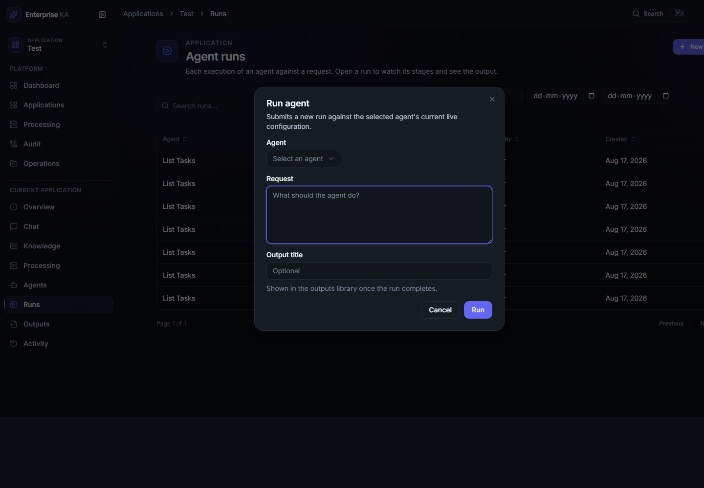

**What the system does:** it snapshots the agent's current configuration and queues
the run. A background worker then progresses through the stages — **Queued →
Preparing → Retrieving → Building context → Generating → Validating → Saving →
Completed** — retrieving evidence, generating a grounded answer, validating
citations, and saving the output. Progress is shown live.

**Expected result:** a **"Run submitted"** confirmation. Open the run to watch the
stage timeline; when it reaches **Completed**, a **View output** action links to the
result.
**How to verify success:** the run status is **Completed** and an output exists.

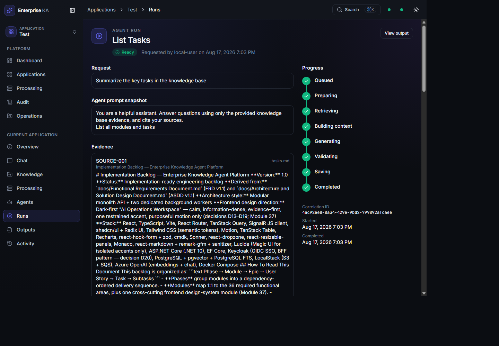

**Alternative paths:** while a run is **Queued** or **Running**, you can
**Cancel** it (confirm "Cancel this run?" — "The run will stop before generation
completes. This cannot be undone."). The run ends **Cancelled**.
**Errors and recovery:** a run can end **Failed**. A common cause is **RetrievalEmpty**
— "No evidence matched this request and strict grounding is enabled for this agent."
Such runs are **retry-eligible**: open the run and select **Retry** (toast "Run
retry queued"), or adjust the agent's retrieval settings/knowledge and run again.
**Permissions and security:** the run records who requested it and preserves the
exact configuration used, for auditability.
**Best practices:** write specific requests; if you get RetrievalEmpty, confirm the
relevant files are **Ready** and enabled, lower **Minimum similarity**, or relax
**Strict grounding** on the agent.
**Related workflows:** [Review an output](#workflow-review-and-manage-an-output).

**Run detail page** shows: the run header with status and "Requested by … on …";
the **Request**; the **agent prompt snapshot**; the retrieved **Evidence**; a
**Parameters** section (Requested, Effective, Retrieval); the **stage timeline**;
and correlation and timing details. Actions include **View output**, **Retry** (when
eligible), and **Cancel** (while runnable).

---

### Outputs

**Purpose.** An **output** is the generated Markdown answer from a completed run,
with its citations. The **Outputs** page is the library of every output in an
application; the detail page lets you read, copy, download, edit, regenerate, or
delete one.

**Who can use it.** Any user with output-view access (Planned: managing requires
output-manage permission). **How to open it:** in an application, select **Outputs**.

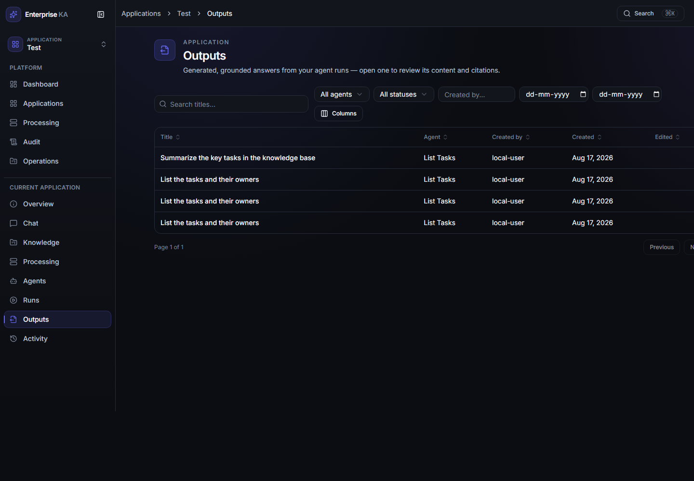

**Page layout**

- Filters: **agent**, **status**, **created-by**, **date range**, and a free-text
  **Search**.
- A sortable **table**: Title, Agent, Status, Created by, Created. Selecting a title
  opens the output detail.

#### Workflow: Review and manage an output

**Purpose:** read and act on a generated answer.
**Who can perform it:** any user (Planned: view vs manage differ by role).
**When to use it:** after a run completes, or any time you revisit results.
**Prerequisites:** an output exists.
**Starting point:** the **Outputs** page; select a title.

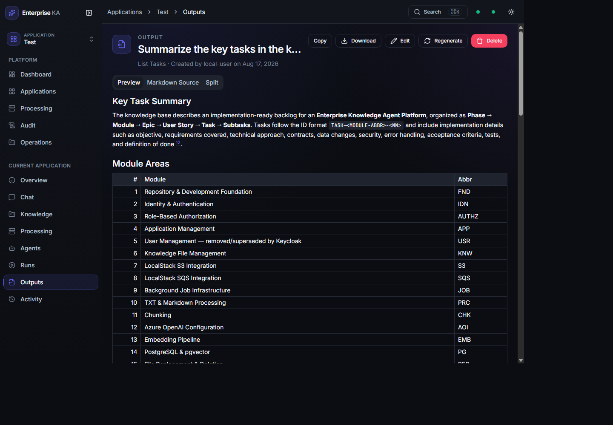

**On the detail page you can:**

- Switch views with the tabs **Preview** (rendered Markdown), **Markdown Source**
  (read-only source), and **Split** (side by side).
- **Copy** the Markdown to the clipboard.
- **Download** the Markdown file.
- **Edit** the Markdown: the editor opens; make changes and select **Save** (toast
  "Output saved"), or **Cancel**. Your edit is stored as the current version; the
  original is preserved.
- **Regenerate**: confirm "Regenerate output?" ("A new run is queued using the
  original request against the agent's current configuration. This output is left
  untouched."); select **Regenerate** (toast "Regeneration started" and you are
  taken to the new run).
- **Delete**: confirm "Delete output?" ("This output will be deleted. This cannot
  be undone from the UI."); select **Delete** (toast "Output deleted").

**Citations and evidence.** Inline citation markers link the answer to the specific
sources the model used, so you can verify each claim. Open the linked evidence to
see the source file, heading, and passage.

**What the system does:** editing stores a new current Markdown while keeping the
original; regenerating queues a fresh run from the same request against the agent's
**current** settings (which may differ from the original run's snapshot).
**Errors and recovery:** "Failed to save/regenerate/delete output" — retry is safe.

> **Warning:** **Delete** cannot be undone from the interface. Prefer **Edit** if
> you only need to correct wording; use **Regenerate** to get a fresh answer while
> keeping the current one.

**Related pages:** [Runs](#runs), [Agents](#agents).

---

### Chat

**Purpose.** **Chat** is a conversational way to ask questions grounded in an
application's knowledge. Answers stream in as they are generated and include
evidence. Each conversation fixes its own settings at creation.

**Who can use it.** Any user with access to the application.
**How to open it:** in an application, select **Chat**.

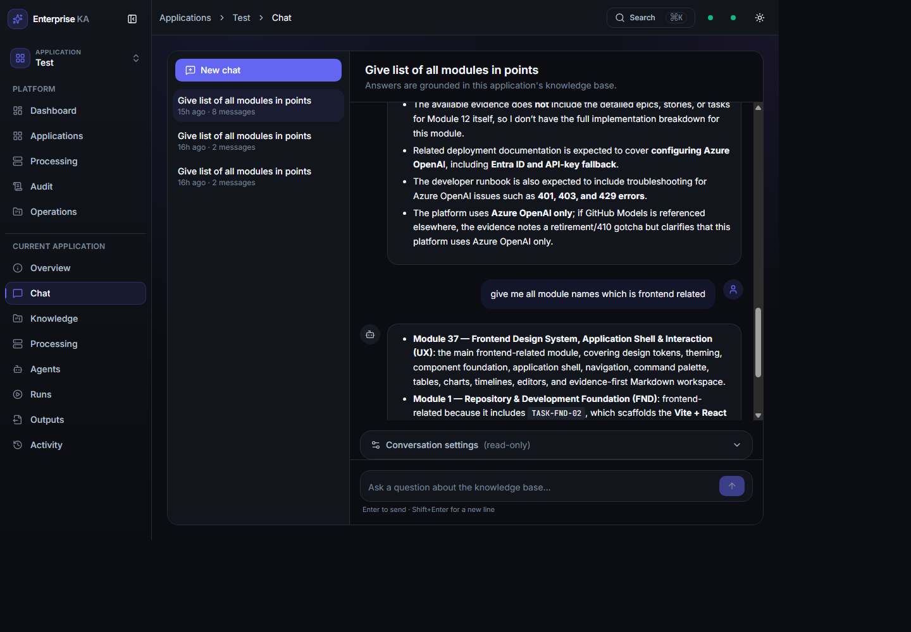

**Page layout**

- A **conversation sidebar** with a **New chat** button and your conversations
  (title, time, and message count), each with a **Rename/Delete** menu.
- The **thread** of messages (you and the assistant).
- The **composer** at the bottom: a message box, a **Send** control, and a
  collapsible **Advanced configuration** panel.

#### Workflow: Ask a question in chat

**Purpose:** get a grounded answer conversationally.
**Who can perform it:** any user with access.
**When to use it:** for quick, iterative questions rather than saved runs/outputs.
**Prerequisites:** **Ready**, enabled knowledge in the application.
**Starting point:** the **Chat** page.

**Steps:**

1. Select **New chat** to start a conversation (or open an existing one).
2. Optionally expand **Advanced configuration** (optional) to set, for this
   conversation only: **Knowledge scope** (All ready files / Selected files only),
   **Files to search**, **Model deployment**, **Retrieval mode** (Semantic /
   Hybrid (semantic + keyword)), **Temperature**, and a **System prompt (persona)**.
3. Type your question in the box ("Ask a question about the knowledge base…").
   **Enter** sends; **Shift+Enter** inserts a new line. Messages are limited to
   4000 characters.
4. Select **Send message** (the up-arrow control).

**What the system does:** on the first message, the conversation snapshots its
settings; the assistant retrieves evidence and streams a grounded answer token by
token. You can stop generation with **Stop generating**.

**Expected result:** the assistant's answer appears and streams to completion, with
evidence attached.
**How to verify success:** the message completes (streaming stops) and shows its
answer; failed messages show a warning with a **Retry** action.
**Alternative paths:** start additional conversations for different topics; each
keeps its own settings.
**Errors and recovery:** if generation fails, the message shows "Something went
wrong generating the answer." with a **Retry** control. Retry is safe.
**Permissions and security:** conversations are shared within the application (there
are no private user accounts in this build).
**Best practices:** choose **Selected files only** to focus a conversation on
specific documents; start a **New chat** to change settings, since a conversation's
settings are fixed once it begins.

> **Note:** A conversation's advanced settings are chosen when the chat starts and
> are then **read-only** ("These settings were chosen when this chat started and are
> fixed for the conversation. Start a new chat to use different settings.").

#### Workflow: Rename or delete a conversation

Open a conversation's menu in the sidebar and choose **Rename** (opens "Rename
conversation" — enter a clearer title, up to 200 characters, then **Rename**) or
**Delete** (confirm "Delete conversation?", then **Delete**).

> **Unverified:** the exact toast messages for rename/delete were not confirmed in
> this pass; the actions themselves are Available.

**Related pages:** [Knowledge](#knowledge), [Outputs](#outputs).

---

### Activity and Audit

**Purpose.** The audit trail records who did what and when. **Activity** (inside an
application) shows that application's events; **Audit** (under PLATFORM) shows events
across all applications. Use them to review changes, executions, and outcomes.

**Who can use it.** Planned: SuperAdmin/SuperViewer. In this build any user can open
them. **How to open it:** **Audit** under PLATFORM, or **Activity** in the CURRENT
APPLICATION group.

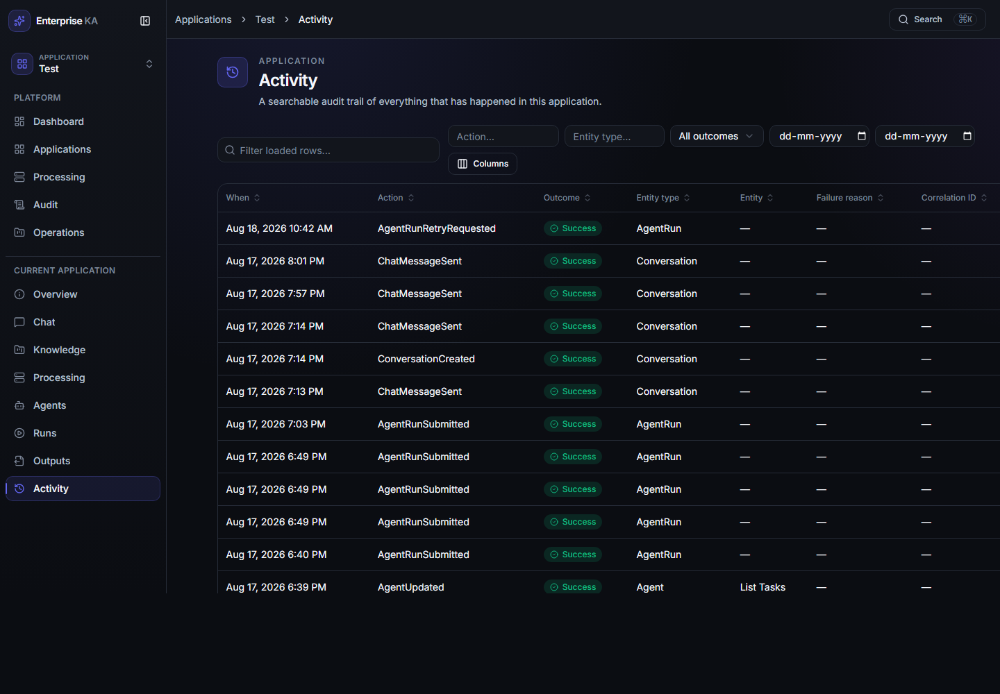

**Page layout**

- Filters such as actor, action, and outcome (and, on the platform view, across
  applications).
- A table of events with timestamp, actor, action, and outcome
  (**Success**/**Failure**), plus the entity affected.

**What the system does.** The audit trail is append-only: entries are recorded as
actions occur and are not edited or removed. In this build the actor is always
`local-user`.

**Best practices:** use Activity to confirm a change took effect (for example, that
an application was archived) and to trace a failed action.

---

### Operations

**Purpose.** **Operations** is the health and diagnostics page: component health,
worker heartbeats, queue depths (including dead-letter counts), and an on-demand
Azure OpenAI reachability check.

**Who can use it.** Planned: SuperAdmin/SuperViewer. In this build any user can open
it. **How to open it:** **Operations** under PLATFORM.

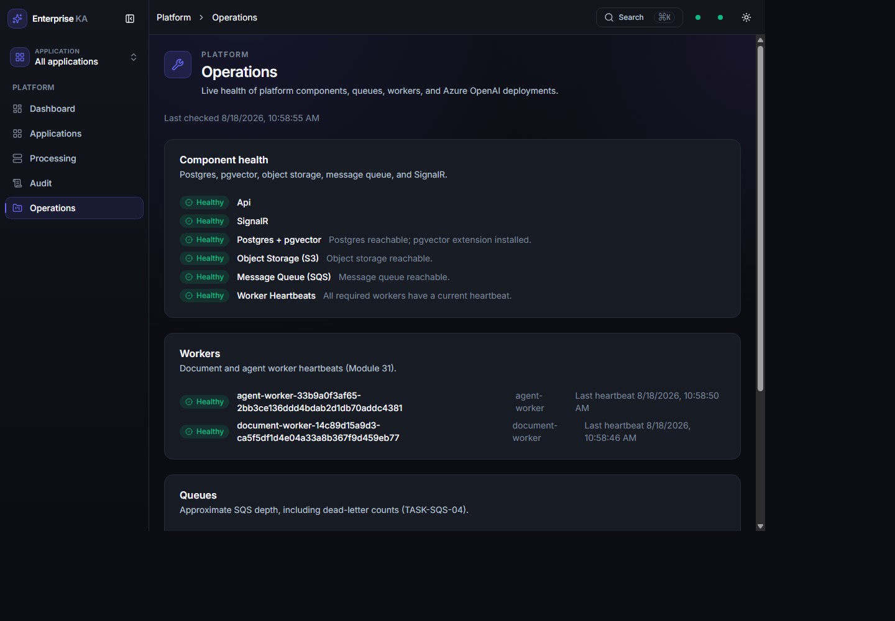

**Page layout**

- **Component health** — API, SignalR (live updates), Postgres + pgvector, Object
  Storage (S3), Message Queue (SQS), and Worker Heartbeats, each **Healthy** or not.
- **Workers** — each background worker with a **Healthy/Stale** badge and its last
  heartbeat time.
- **Queues** — each queue's approximate **Depth** and **Dead-letter** count.
- **Azure OpenAI** — a **Run deep check** button that actively tests reachability
  (kept manual to avoid consuming model quota).

**When to use it.** If uploads or runs are not progressing, open Operations: confirm
workers are **Healthy**, queues are draining (low depth, zero dead-letter), and run
the Azure OpenAI **deep check**. A non-zero dead-letter count indicates messages
that failed repeatedly and need attention.

**Related pages:** [Processing](#processing), [Dashboard](#dashboard).

---

## Command palette

The command palette gives keyboard-first access to common actions and pages.

- **Open it:** press `Ctrl+K` (`⌘K` on macOS), or select **Search** in the header.
- **Type** in "Type a command or search…" to filter; if nothing matches you see "No
  matching commands."
- **Run** a command with Enter or by selecting it.

Available commands (grouped; some appear only when an application is open):

| Group | Command | What it does |
| --- | --- | --- |
| Applications | Create application | Opens the create-application dialog |
| Applications | Switch application | Change the current application context |
| Current application | Upload knowledge | Opens the upload dialog (needs an open application) |
| Current application | Create agent | Opens the create-agent dialog |
| Current application | Run agent | Opens the run dialog |
| Current application | Search outputs | Jumps to the outputs library |
| Navigate | Open processing | Opens processing (application or platform, by context) |
| Navigate | View failed jobs | Opens processing filtered to failures |
| Navigate | Open system health | Opens Operations |
| Preferences | Change theme | Switches between dark and light |

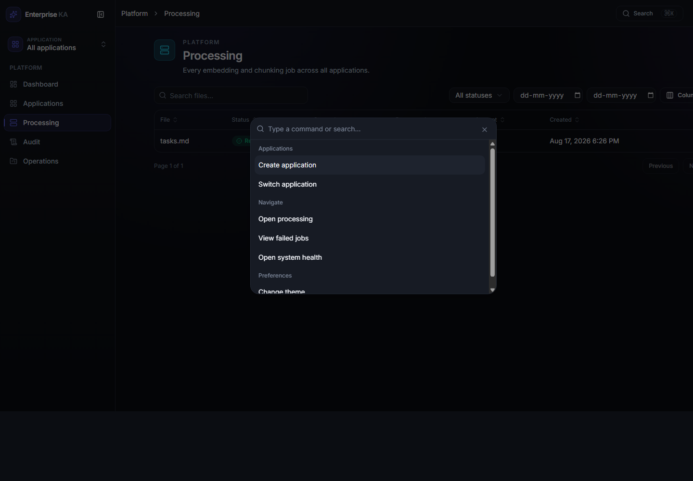

> **Note:** The commands shown adapt to context and (in the Planned role model) to
> permissions. With one full-access role in this build, the context (whether an
> application is open) is what changes the list.

---

## How processing works

Understanding the background pipeline helps you interpret statuses and recover from
failures.

**Knowledge file lifecycle**

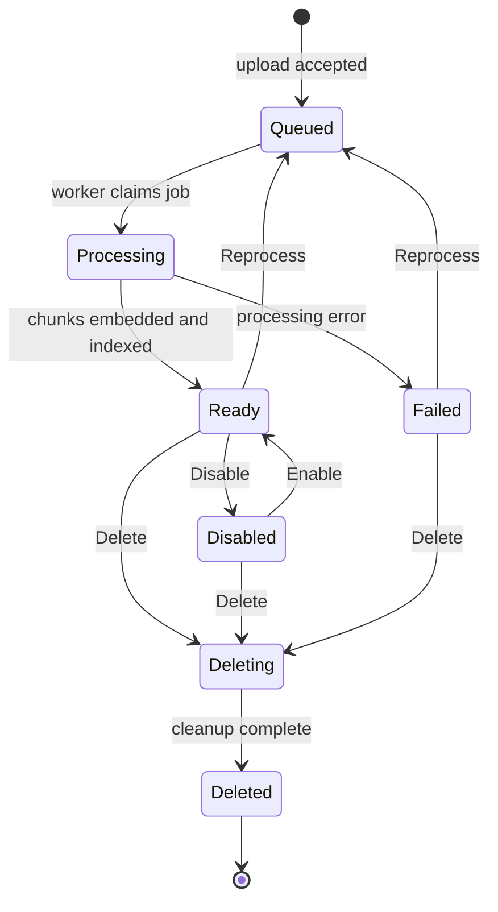

When you upload a file, it is stored and a job is **Queued**. A background worker
claims it, parses the text, splits it into overlapping **chunks**, generates
**embeddings** (numeric representations used for semantic search) via Azure OpenAI,
and indexes them. The file becomes **Ready**. Errors send it to **Failed**, from
which **Reprocess** re-queues it. Deleting a file cleans up its stored content
asynchronously (**Deleting** → **Deleted**).

**Agent run lifecycle**

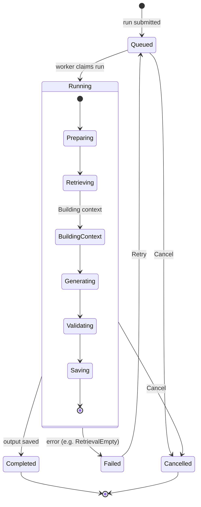

A submitted run is **Queued**, then a worker retrieves evidence, builds the context,
generates the answer, validates its citations, and saves the output — ending
**Completed**. Failures (such as **RetrievalEmpty** under strict grounding) are
**retry-eligible**. You can **Cancel** a run before it finishes.

> **Note:** Jobs and runs are processed **at least once** with automatic recovery if
> a worker restarts mid-task, so a transient hiccup usually resolves without your
> intervention. The **Attempt** number on processing jobs reflects retries.

---

## Forms and Controls Reference

Controls behave consistently across the application.

- **Text inputs / text areas:** show a placeholder as a hint; required fields are
  validated on submit with an inline message (for example, "Name is required").
  Character limits apply (for example, application/agent name ≤ 200; description ≤
  2000; agent prompt ≤ 100,000; run request ≤ 20,000; chat message ≤ 4000).
- **Prompt / Markdown editors:** a code editor with line numbers is used for agent
  prompts and for editing output Markdown.
- **Selects / dropdowns:** for fixed choices such as model deployment, retrieval
  mode, and status filters.
- **Sliders and presets:** temperature can be set by a preset button (Precise /
  Balanced / Creative / Custom) or a slider; the current value is shown in the label.
- **Checkboxes / toggles:** for on/off options (include neighbors, strict grounding,
  citations required, allow viewers to run agents).
- **Buttons:** the primary action is filled (for example, **Create**, **Save**,
  **Run**, **Upload**); secondary actions are outlined (**Cancel**); destructive
  actions (**Delete**) are styled as a warning and always ask for confirmation.
- **Tables:** a **Search** box filters rows; column headers sort; a **Columns**
  control toggles visibility; **Previous/Next** paginate; a **Row actions** menu
  holds per-row commands.
- **Tabs:** switch views without leaving the page (for example, output
  Preview/Markdown Source/Split).
- **Upload control:** a dropzone that accepts `.txt`/`.md` files; each selected file
  can be removed before uploading.
- **Copy / Download:** available on outputs.
- **Confirmation dialogs:** every destructive or state-changing action (archive,
  delete, disable, reprocess, regenerate, cancel) opens a dialog stating the
  consequence before you proceed.

> **Tip:** When a primary button is disabled, a required value is usually missing —
> for example, **Upload** is disabled until you select at least one file, and an
> output **Save** is disabled while the draft is empty.

---

## Status and Progress Reference

Every status is shown with an **icon and a text label**, never color alone, so it
stays clear in both themes.

**Base status styles**

| Status | Meaning |
| --- | --- |
| Queued | Waiting to be processed |
| Processing | Actively being worked on (animated); may show a percentage |
| Ready | Completed successfully / available |
| Warning | Needs attention |
| Failed | Ended in error |
| Disabled | Excluded or turned off |

**Knowledge file**

| Status | Meaning | User action | Next state |
| --- | --- | --- | --- |
| Queued | Upload accepted, waiting | Wait | Processing |
| Processing (X%) | Being parsed/embedded | Wait | Ready or Failed |
| Ready | Searchable and enabled | Use it; optionally Disable/Reprocess | Disabled/Queued |
| Failed | Processing error | Reprocess, or Delete | Queued/Deleting |
| Disabled | Excluded from retrieval | Enable to re-include | Ready |
| Deleting | Cleanup in progress | Wait | Deleted |
| Deleted | Removed from retrieval | None (historical outputs remain) | — |

**Processing job / Agent run**

| Status | Meaning | User action | Next state |
| --- | --- | --- | --- |
| Queued | Waiting for a worker | Wait; optionally Cancel (runs) | Running/Cancelled |
| Running (Processing) | In progress (see Stage) | Wait; optionally Cancel (runs) | Completed/Failed |
| Completed (Ready) | Finished successfully | Open the output (runs) | — |
| Failed | Ended in error | Retry if eligible; fix inputs | Queued |
| Cancelled | Stopped by a user | Submit a new run if needed | — |

**Run stages (in order):** Queued → Preparing → Retrieving → Building context →
Generating → Validating → Saving → Completed. The current stage is highlighted; a
percentage shows within the active stage.

**Application:** Active (in use), Archived (read-only until restored), Deleted (soft
-deleted; outputs remain viewable). **Agent:** Active (runnable), Disabled (not
runnable), Deleted (soft-deleted).

---

## Settings and Configuration

There are three places you configure behavior as a user.

**1. Agent settings (live, reusable).** Configured on the agent detail page and
applied to every future run (past runs keep their snapshot). See [Configure an
agent](#workflow-configure-an-agent). Key fields:

- **Prompt** — required instructions; the biggest lever on answer quality.
- **Deployment / Preset / Temperature / Maximum output tokens / Top P** — control
  the model and how it writes.
- **Retrieval mode / Retrieval count / Minimum similarity / Maximum evidence
  tokens / Include neighbors** — control how evidence is gathered.
- **Strict grounding / Citations required** — enforce sourced answers.
- **Knowledge scope** — All ready files, or Selected files only.

**2. Conversation settings (per conversation, fixed at start).** Set in the chat
**Advanced configuration** panel when a conversation begins; read-only afterward.
Start a **New chat** to use different settings.

**3. Application settings.** Name, description, and **Allow viewers to run agents**
(stored but without effect in this build).

**4. Preferences.** **Theme** (dark/light) via the header toggle or the **Change
theme** command; your choice is remembered in the browser.

> **Important:** Changing an agent's settings affects **future** runs only. To
> reproduce a past result, use the run's snapshot (shown on the run detail) rather
> than assuming the agent is unchanged.

---

## Notifications and Messages

- **Success toasts** briefly confirm an action, for example "Application created",
  "Agent saved", "File queued for reprocessing", "Run submitted", "Output saved",
  "Regeneration started".
- **Error toasts** start with "Failed to …" (for example, "Failed to upload files").
  They indicate the action did not take effect; retry is generally safe.
- **Confirmation dialogs** precede destructive or state-changing actions and state
  the consequence (for example, "Delete file?").
- **Persistent alerts** appear as banners — for example, the dashboard **attention
  banner** for failed runs — and remain until the underlying condition clears.
- **Inline messages** appear beside fields for validation ("Name is required") and
  as page-level alerts when data cannot load.

Toasts appear in the notifications region (reachable with `Alt+T`). They dismiss
automatically; you do not need to act on a success toast.

---

## Error Recovery

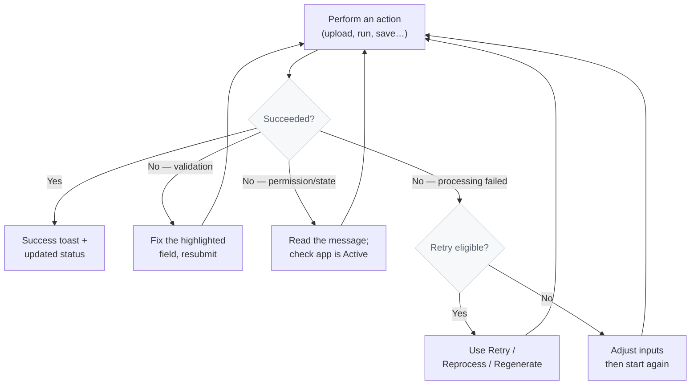

| Situation | What you see | Recovery |
| --- | --- | --- |
| Missing/invalid input | Inline validation ("Name is required", limits) | Correct the field and resubmit |
| Editing an archived application | Change is blocked | **Restore** the application first |
| Upload rejected | Per-file reason (type/size/duplicate) | Fix the file; only `.txt`/`.md` up to 10 MiB |
| File processing failed | File status **Failed** | Open the file → **Reprocess**; check Operations/Azure OpenAI |
| Run failed (RetrievalEmpty) | "No evidence matched … strict grounding …" | **Retry**, add/enable knowledge, lower similarity, or relax strict grounding |
| Run/output action failed | "Failed to …" toast | Retry the action (safe) |
| Live updates dropped | Header shows reconnecting | Wait; lists refresh when reconnected — avoid assuming stale values |
| Nothing processes | Jobs stay Queued | Check [Operations](#operations): workers Healthy, queues draining, Azure OpenAI reachable |

Because work is processed **at least once** with automatic recovery, retrying after
a transient error is safe and will not create duplicate outputs for the same run.

---

## Best Practices

- **Keep knowledge focused.** One application per subject; upload related documents
  together. Structured Markdown (clear headings) improves chunking and citations.
- **Wait for Ready.** Agents only retrieve from **Ready**, enabled files. Check the
  Knowledge page before running.
- **Keep grounding on.** Leave **Strict grounding** and **Citations required**
  enabled for trustworthy, sourced answers; accept that irrelevant questions will
  fail rather than be answered without evidence.
- **Tune retrieval deliberately.** If answers miss context, raise **Retrieval
  count** or switch to **Hybrid**; if they include noise, raise **Minimum
  similarity**.
- **Use presets first.** Start with **Balanced**; drop to **Precise** for factual
  extraction, raise to **Creative** for drafting.
- **Prefer Edit or Regenerate over Delete** for outputs you might still need.
- **Use Archive over Delete** for applications you may revisit.
- **Verify with citations.** Open the evidence behind an answer before relying on it.

---

## Security Guidance

- **No authentication.** Anyone who can reach the URL has full access, including
  destructive actions. Restrict network access to the environment accordingly.
- **Shared data.** There are no private user views; every conversation, run, and
  output is visible to anyone using the app. Do not enter information you would not
  share with everyone who can reach the URL.
- **Destructive actions** (delete application/agent/file/output, archive) always ask
  for confirmation and state their consequence. Read the dialog before confirming.
- **Isolation is enforced** between applications even without login: one
  application cannot read another's data.
- **Secrets are protected server-side.** The Azure OpenAI key is never shown in the
  interface; do not attempt to surface credentials through the app.
- **Sessions.** There is no session or logout; close the tab to stop using the app.

> **Warning:** Deletions of outputs cannot be undone from the interface, and
> deleted/archived applications affect everyone. Confirm you are acting on the
> intended item before proceeding.

---

## Accessibility and Keyboard Use

- **Status is conveyed with icons and text**, not color alone.
- **Command palette:** `Ctrl+K` / `⌘K` to open; type to filter; arrow keys to move;
  Enter to run; Escape to close.
- **Chat composer:** **Enter** sends, **Shift+Enter** adds a new line.
- **Dialogs and menus** are keyboard-navigable (Tab/Shift+Tab, Enter, Escape to
  close), built on accessible UI primitives.
- **Notifications** region is reachable with `Alt+T`.
- **Breadcrumbs and links** carry descriptive text; every step in this manual is
  written to be followed without relying on a screenshot.
- **Theme** can be switched to light or dark to suit contrast preferences.

> **Unverified:** a formal accessibility audit (for example, WCAG conformance level)
> has not been performed on this build; the notes above describe observed, built-in
> behavior.

---

## Troubleshooting

Organized by symptom.

**I open the app but see "Health status unknown" or "Connecting to live updates…".**
The stack may still be starting or a dependency is unavailable. Wait a few moments;
open [Operations](#operations) to check component health. If it persists, the
environment may need attention (see the project README).

**My uploaded file stays Queued or Processing forever.**
A worker or the Azure OpenAI connection may be unavailable. Open
[Operations](#operations): confirm workers are **Healthy** and queues are draining,
and use **Run deep check** for Azure OpenAI. If the file reaches **Failed**,
**Reprocess** it from the Knowledge page.

**My run fails immediately with "No evidence matched this request …".**
The agent uses **Strict grounding** and retrieval found nothing relevant. Confirm
the right files are **Ready** and enabled, broaden **Knowledge scope**, lower
**Minimum similarity**, increase **Retrieval count**, or relax **Strict grounding**
on the agent — then **Retry** the run.

**I can't create an agent; a message mentions no chat deployment.**
The server has no chat deployment configured. This is an environment configuration
task (Azure OpenAI); creation is blocked until it is set.

**A button is disabled.**
A required input is missing (for example, no file selected for **Upload**, or an
empty draft for output **Save**). Provide the input to enable the button.

**I edited an application but the change was rejected.**
The application is **Archived** (read-only). **Restore** it, then edit.

**Lists look out of date.**
The live connection may be reconnecting (see the header indicator). Values refresh
automatically once reconnected.

**An action showed "Failed to …".**
The action did not take effect. Retry it — retries are safe and will not duplicate
completed work.

---

## Frequently Asked Questions

**Do I need an account or password?**
No. There is no login; opening the URL gives full access. Actions are recorded as
`local-user`.

**Why don't the roles in the documentation appear?**
Authentication and roles are **Planned**, not implemented in this build. Everyone
has full access. The "Allow viewers to run agents" setting is stored but inactive.

**What file types can I upload?**
`.txt` and `.md` only, up to 10 MiB each. Other types are **Planned/Unavailable**.

**Why did my answer come back empty or failed?**
Most often, retrieval found no matching evidence while **Strict grounding** was on.
Add/enable relevant knowledge or adjust retrieval settings, then retry.

**What's the difference between a run and a chat?**
A **run** executes an agent against a single request and saves a durable **output**
with citations; **chat** is an interactive conversation grounded in the same
knowledge. Runs are best for repeatable, saved results; chat for exploration.

**If I change an agent, do old outputs change?**
No. Each run snapshots the agent's settings, so past runs and outputs are
unaffected. **Regenerate** creates a new run using the agent's current settings.

**How do I know an answer is trustworthy?**
Check its **citations** and open the linked **evidence** to see the exact source
passages.

**Can I get my output out of the app?**
Yes — **Copy** or **Download** the Markdown from the output detail page.

**Is my data private to me?**
No. There are no private user views in this build; everything is shared with anyone
who can reach the app.

**How do I switch between light and dark?**
Use the theme toggle in the header, or the **Change theme** command in the palette.

---

## Glossary

- **Application** — an isolated workspace grouping knowledge, agents, runs, and
  outputs.
- **Knowledge file** — an uploaded `.txt`/`.md` document that agents can retrieve
  from.
- **Chunk** — a segment of a file created during processing; the unit that gets
  embedded and searched.
- **Embedding** — a numeric representation of text that enables semantic (meaning-
  based) search.
- **Retrieval** — finding the most relevant chunks for a request. **Semantic** uses
  embeddings; **Hybrid** combines semantic and keyword matching.
- **Agent** — a reusable assistant defined by a prompt plus generation and retrieval
  settings.
- **Run** — a single execution of an agent against a request.
- **Stage** — a step within a run (Retrieving, Generating, Saving, …).
- **Output** — the generated Markdown answer from a run, with citations.
- **Citation / Evidence** — the link from an answer to the specific source passages
  it used.
- **Conversation** — a chat thread grounded in an application's knowledge, with
  settings fixed at creation.
- **Strict grounding** — a setting that makes an agent refuse to answer when no
  evidence matches, rather than answer unsupported.
- **Deployment** — the specific model the agent uses to generate answers.
- **Temperature** — how creative/varied the model's output is (lower = more
  focused).
- **Dead-letter** — a queue for messages that failed repeatedly and need attention.
- **Heartbeat** — a periodic "I'm alive" signal from a background worker.
- **Soft delete** — removal that preserves historical records (past outputs remain
  viewable).

---

## Known Limitations

- **No authentication, accounts, or roles** — one full-access context;
  role-based restrictions and the viewer-execution setting are inactive (**Planned**).
- **File types** limited to `.txt` and `.md`, 10 MiB each; no PDF/DOCX/image/audio/
  video (**Planned/Unavailable**).
- **No export** beyond copy/download of an output's Markdown; no DOCX/PDF export
  (**Planned**).
- **Azure OpenAI required** — without a configured, reachable resource, uploads
  cannot finish processing and runs/chat fail.
- **Shared, non-private data** — everything is visible to anyone who can reach the
  app.
- **Output deletion is irreversible** from the interface.
- **Conversation rename/delete confirmation text** was not individually verified
  (**Unverified**); the actions work.

---

## Support

There is no dedicated in-app support channel. For problems or questions, use the
project's issue tracker. For deployment, configuration, and startup, see the
project [README](../README.md). For intended design and requirements (some of which
are Planned), see the documents in the [Documentation Index](#documentation-index).

---

## Documentation Index

- [Project README](../README.md) — setup, configuration, running, and testing.
- [README analysis](readme-analysis.md) — how the README was verified, including
  documentation conflicts.
- [User manual analysis](user-manual-analysis.md) — planning and verification
  behind this manual, including the page/control/workflow inventories and coverage
  tables.
- [Screenshot inventory](screenshots/README.md) — capture standards and the list of
  every image used here.
- [Diagram sources](diagrams/) — editable Mermaid sources for the diagrams in this
  manual.
- [Architecture and Solution Design Document](Architecture%20and%20Solution%20Design%20Document.md)
  and [Functional Requirements Document](Functional%20Requirements%20Document.md) —
  design intent (note: some described features are Planned, not implemented).
